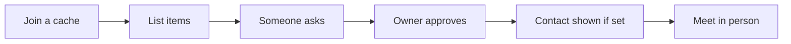
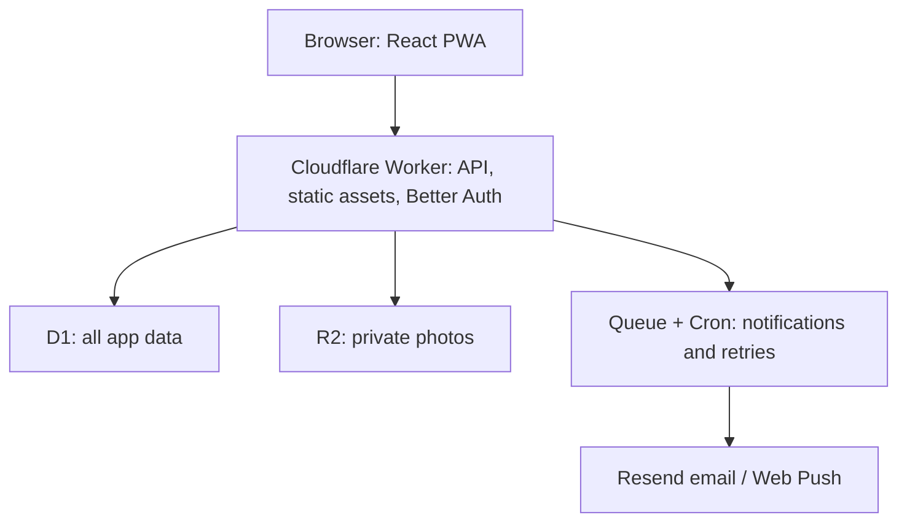

<p align="center"></p>

# Communal Cache

Share useful things with people you know.

Communal Cache is a small app for a close community to share household items.
Join a cache (a group), list things you can lend or give away, and ask to use
someone else's things; the owner approves and you hand them over in person.
No addresses, delivery logistics or loan tracking.

[Visit communalcache.com](https://communalcache.com)

## How it works



## Architecture

One Worker serves the app and API, with one database for all app data.
Photos stay private; background notifications use email or web push.



## Run locally

Requires Node.js 22.12 or newer. Install dependencies and copy the local settings:

```bash
npm install --silent
npm --prefix web install --silent
cp .dev.vars.example .dev.vars
```

In `.dev.vars`, set `BETTER_AUTH_SECRET` to a fresh local-only secret of at least
32 characters. Keep both app URLs set to `http://localhost:8787`; never commit
secrets. Email sign-in and bot checks need provider settings—see the
[local setup guide](docs/deploy.md). For a provider-free UI walkthrough, run
`npm run ui:fixture` and open `http://127.0.0.1:4173/login` instead.

Build the web app, apply migrations to the local database, and start the Worker:

```bash
npm --prefix web run build --silent
CLOUDFLARE_LOAD_DEV_VARS_FROM_DOT_ENV=false npx --no-install wrangler d1 migrations apply communalcache --local
npm run dev
```

Open `http://localhost:8787`. Run the tests with `npm test -- --silent`.
Tests use local Cloudflare bindings and mock external providers; don't use production credentials.

## Docs

- [Plan](docs/plan.md) — product scope and architecture decisions.
- [Build guide](docs/build-guide.md) — implementation status and validation checks.
- [Database](docs/database.md) — schema, migrations and local database tests.
- [Deploy](docs/deploy.md) — setup, deployment and operations.
- [AGENTS.md](AGENTS.md) — contributor and agent rules.

## License

Copyright (C) 2026 Ryan Zhou. Licensed under the [GNU AGPL v3.0](LICENSE): if you run a modified copy as a service, you must share its source.
