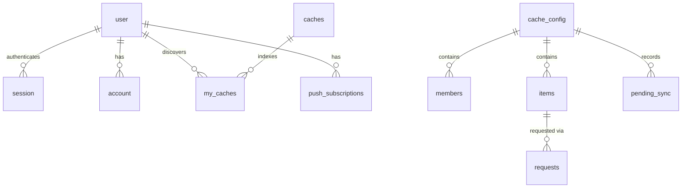

# Communal Cache MVP

## Scope decisions

- Sign in primarily with an email containing only a magic link, no passwords.
  “Email me a code instead” explicitly sends the six-digit code fallback in a
  separate email. No combined link+code email; phone/SMS is deferred.
- Web push for notifications, email via Resend as fallback.
- No return tracking, holder tracking, or loan state. A request ends at `approved` or `rejected`.
- Non-consumables have no quantity. Only consumables do.
- Join by unguessable invite link. No password. Optional per-cache owner approval.
- One notification per request. No throttle.
- No addresses stored anywhere.

This is the target architecture, not a description of code already ported. The Go
foundation is live; Go Caches/Joining in PRs #2/#3 are references to be superseded.
The existing deployment and Supabase Postgres stay live until an approved cutover.
This spec change creates no resources and decommissions nothing.

## Data model



One **SQLite-backed Durable Object (DO) per cache** is the source of truth for its
membership, settings, items, and requests. D1 holds global users and discovery
projections. There is no cross-store transaction or foreign key.

App IDs are text UUIDs generated with `crypto.randomUUID()` before writes; app
user ID equals **Better Auth `user.id`**, with its `generateId: 'uuid'` option.
App timestamps are **integer Unix milliseconds**, supplied by the Worker/DO, with
`created_at NOT NULL`; auth columns retain the pinned library's generated schema
and adapter date conversions. Booleans use SQLite integers constrained to 0/1.
Keys/statuses are `NOT NULL`; nullable quantities/decision timestamps remain
nullable deliberately. All app SQL binds parameters, never interpolated input.

### Global D1

- Better Auth `user`, `session`, `account`, `verification`, and `rateLimit` tables:
  auth identity/email, D1-backed sessions, account records, hashed OTP challenges
  and persistent auth rate limits. App user IDs reference `user.id`; email for
  notifications comes from that user's private auth row. No duplicate app email
  identity or separate `users` table.
- `user.display_name TEXT` — nullable app profile field, declared as a Better Auth
  additional field and set only through `PATCH /api/me`. Do not use the library's
  core `name` (or an email-derived default) as the community display name.
- Auth migrations are hand-written/reviewed SQL derived from the exact pinned
  Better Auth schema generator output, including plugin/rate-limit fields. Apply
  with Wrangler D1 migrations, not a public migration endpoint or runtime auto-DDL.
  The native D1 adapter is documented; no `kysely-d1` dependency is needed.
- `caches` — `id TEXT PRIMARY KEY`, `name TEXT NOT NULL`. A registry/projection,
  **not** the authority on cache ownership, membership, settings, or invite secrets.
- `my_caches` — `PRIMARY KEY (user_id, cache_id)`, both text, references to global
  `user`/caches. A reverse index for home-screen discovery and requests fan-out only.
  A missing row can hide a cache temporarily; a stale row can produce a 404 tap.
  Neither grants access.
- `push_subscriptions` — `id`, `user_id REFERENCES user ON DELETE CASCADE`,
  `endpoint TEXT UNIQUE NOT NULL`, `p256dh TEXT NOT NULL`, `auth TEXT NOT NULL`.
- `outbox` — `id TEXT PRIMARY KEY` generated in the DO, `kind TEXT NOT NULL`,
  `dedupe_key TEXT NOT NULL`, `UNIQUE(kind, dedupe_key)`, `payload TEXT NOT NULL`
  containing validated JSON, `attempts INTEGER NOT NULL DEFAULT 0`,
  `claim_until INTEGER`, `claim_token TEXT`, `sent_at INTEGER`, `failed_at INTEGER`.
  Payloads snapshot recipient IDs, item titles, reasons and destination links; they
  survive deletion of the originating item. Index unsent work and discovery lookups.

### Each cache DO's private SQLite database

- `cache_config` — singleton: cache UUID, name, `join_secret TEXT NOT NULL`,
  `requires_approval` boolean. Generate the secret from 32 random bytes, base64url.
- `members` — `user_id TEXT PRIMARY KEY`, `role TEXT NOT NULL CHECK(role IN
  ('owner','member'))`, `status TEXT NOT NULL CHECK(status IN
  ('active','pending','removed'))`. Exactly one active owner, created with the cache;
  that role is the single ownership authority. No ownership copy in D1.
- `items` — `id`, `owner_id TEXT NOT NULL REFERENCES members(user_id)`,
  `title TEXT NOT NULL`, `description TEXT`, `photo_path TEXT`, `is_consumable`
  boolean, `quantity INTEGER`; `CHECK(is_consumable = (quantity IS NOT NULL))`
  and `CHECK(quantity IS NULL OR quantity BETWEEN 0 AND 9999)`.
- `requests` — `id`, `item_id REFERENCES items ON DELETE CASCADE`,
  `requester_id REFERENCES members(user_id)`, `quantity INTEGER`, `status TEXT
  NOT NULL CHECK(status IN ('pending','approved','rejected'))`,
  `decision_reason TEXT`, `decided_at INTEGER`, plus:
  - `CHECK(quantity IS NULL OR quantity BETWEEN 1 AND 9999)`
  - `CHECK((status = 'pending') = (decided_at IS NULL))`
  - `CHECK(status <> 'rejected' OR decision_reason IS NOT NULL)`
  - partial index on `(item_id) WHERE status = 'pending'` for reservations.
- `pending_sync` — durable ordered work: monotonic local sequence, unique intent
  ID, kind, JSON payload, creation time. Contains registry/reverse-index updates,
  DO-generated outbox rows, and R2 deletes. It is written in the **same local
  transaction** as the change it describes.
- Schema version metadata — incremented with each constructor migration.

Cache IDs are implicit in local tables; responses include the cache ID for links.
Local references do not reach the D1 auth user table. The Worker fetches display names from D1
by returned user IDs **after** the DO has authorized and fetched the data; eventual
name updates are fine. Never fetch emails for member or request responses.

`is_consumable` is immutable. Changing it would strand quantities and pending
reservations; nobody needs to turn a mixer into brown sugar.

### Display name onboarding

First successful email-link or code sign-in starts with `display_name = NULL`. Do not derive a name from the
email's local part: that leaks part of everyone's email to the community.
`requireProfile` returns `409 profile_incomplete` on cache, item and request writes;
the SPA routes to "what should neighbors call you?".

`PATCH /api/me`, push subscription routes and `/api/auth/*` are **exempt**. Gating
profile setup or authentication would leave a new user with no way out.

### The over-booking guard

For a consumable:

`available = items.quantity - COALESCE(SUM(requests.quantity) WHERE status = 'pending', 0)`

Every cache check-then-write runs inside **one `ctx.storage.transactionSync`**:

```typescript
ctx.storage.transactionSync(() => {
  requireActiveMember(userId); // throw 404
  const item = readItem(itemId); // throw 404 if absent
  const pending = readPendingSum(itemId);
  if (qty > item.quantity - pending) throw conflict();
  insertRequest(requestId, userId, qty);
  insertPendingSync(notificationIntent);
});
```

This is the shape, not proposed helper APIs. There is **no `await` inside**. The
callback can read SQL, decide in JavaScript, then write SQL; throwing rolls back
all its local changes. [Cloudflare documents these semantics](https://developers.cloudflare.com/durable-objects/api/sqlite-storage-api/index.md#transactionsync).
An external await such as D1/fetch can let other events interleave: a DO is not a
mutex around an entire async handler. [Storage gates do not replace this rule](https://developers.cloudflare.com/durable-objects/api/state/index.md#blockconcurrencywhile).

- **Create**: active membership, not the item's owner; request quantity is `NULL`
  for non-consumables, otherwise a positive integer 1–9999. Validate type and
  availability against the local item inside the transaction; insufficient stock
  returns 409. Insert request plus notification intent together.
- **Approve**: check item ownership and pending status, then guarded
  `UPDATE requests ... WHERE status='pending'`; zero changed rows returns 409.
  Deduct consumable stock and insert the notification intent in that same
  transaction. Available stock is unchanged: reservation becomes real deduction.
- **Reject**: same pending guard, required reason, decision timestamp, notification
  intent; removing the pending reservation releases availability.
- **Edit quantity**: check owner and require new stock at least the pending sum;
  throw 409 below it. Restocking upward is unconstrained within 0–9999.

Consume SQL cursors synchronously, before any await. Cache mutations need neither
Postgres row locks nor a lock order: checks, cascades and intents share one local
synchronous transaction.

## Authorization

### The data boundary

D1 and DO storage are server-side bindings, not a browser-facing database API.
Better Auth runs in our Worker; the browser holds a same-origin session cookie,
not a D1/DO management credential or a provider anon key. Cache access goes through
that Worker and its authoritative DO. The target has no Supabase dependency.

- **`app` schema dropped:** SQLite has no equivalent application schema boundary;
  application tables no longer live in Supabase Postgres.
- **RLS dropped:** D1/DO storage is not exposed through PostgREST; authorization is
  the cache DO's live membership check, not per-user SQL policies.
- **Data API invariant dropped for the target stack:** it has no Supabase service
  or PostgREST tables. Preserve existing protections on legacy Supabase/Postgres
  until approved decommissioning.
- **`DATABASE_URL`/pooling invariant dropped:** bindings replace pgx connections;
  migrations no longer depend on a session advisory lock.

### The photo bucket is private

R2 has no public domain or `r2.dev` access enabled. Uploads use the Worker's R2
binding. Reads call the cache DO's `photoKey(user, item)` and stream the result
through the Worker with `Cache-Control: private`. No signed URLs or browser storage
credentials are needed. Authorization is checked on each read; do not share-cache
an authorized image response.

### Application checks

The Worker routes by **cache ID in the path**. The DO checks active membership and
fetches data in the same synchronous operation; any check-then-write is in the
same `transactionSync` as the mutation. Do not pre-check in D1 or trust
`my_caches`, registry rows, session metadata, or a previous request. A
non-member, pending member or removed member gets **404, not 403**, for cache data.

Policy per route:

- Active member: cache detail (including shareable invite link and member list),
  item list/detail, pending queue, and photo reads; item creation takes `owner_id`
  from the caller, never the request body.
- Item owner, still active: item edits/deletion/photo uploads and request decisions.
- Active member other than the item owner: request creation.
- Active cache owner (`members.role='owner'`): settings, secret rotation, gated
  join queue/decisions, member removal.
- Authenticated and caller-scoped: `/api/me`, cache creation/discovery, push
  subscription writes, cross-cache requests discovery. Each fan-out DO separately
  authorizes access before returning data.

Cache creation inserts config plus the owner's active membership and durable
registry/reverse-index intents atomically in the new DO. Navigate straight to that
cache page; do not wait for the eventually updated home-screen list.

The pending queue deliberately returns requester display name, quantity,
`created_at`, `user_id` and `request_id` to every active member. Decided requests
remain visible only to the requester and item owner. IDs support keys and actions;
**app emails appear only in `GET /api/me`, only your own authenticated user**.
Better Auth endpoints may return the caller's own session/user, never another
user's email; do not enable admin/list-users or public user lookup endpoints.

Removal is effective on the next DO call even with a valid session. Already authorized
in-flight responses are not recalled; D1 discovery drift never grants new access.

## Membership lifecycle

- **Join** `POST /api/caches/{cacheId}/join` with body `{secret}`: Worker opens that
  DO directly; the DO compares the decoded, fixed-length secret in constant time.
  No D1 token lookup table. A mismatch or missing cache returns 404. The secret is
  a shareable bearer capability (anyone with the link may join or ask to join), so
  it travels in the body, not the API path, to keep it out of request logs.
  The SPA `/join/...` page sends `Referrer-Policy: no-referrer`.
- Insert `active`, or `pending` if approval is required. A `removed` member row is
  untouched and returns 403 on the valid-secret join route: otherwise removal is
  meaningless while the link remains in the group chat. This is the explicit join
  exception, not a change to direct cache-data 404s.
- **Join rejected**: delete the pending row, not mark it removed, so a mistaken
  rejection can be retried. Approval/rejection snapshots recipients into
  `pending_sync` before any deletion.
- **Owner** cannot be removed or remove themselves. No ownership transfer.
- **Removal**: one local transaction checks the owner, marks the target removed,
  deletes their items, rejects their pending requests on surviving items with
  reason "left the cache", and records reverse-index, notification and R2 cleanup
  intents. Request creation cannot slip between those steps.

Removal and item deletion ship only with their cascades. Earlier deployable
features do not expose destructive endpoints that strand items or silently erase
requests before notification recording exists.

### What deletion does to requests

- Deleted items lose requests through `ON DELETE CASCADE`. Snapshot each pending
  requester and item title into `pending_sync` **inside the deletion transaction,
  before deleting**; the notification carries the whole story because no request
  row survives. R2 cleanup also becomes a durable intent.
- A removed member's pending requests on surviving items are rejected, not deleted,
  leaving the reason visible to both parties.

Both paths are one `transactionSync`. A racing request either fails with 404, or
commits before the cascade and is included in its durable notification snapshot.
There is no lock-before-snapshot or lock-order invariant for cache-local data.

## Backend

One TypeScript module Worker handles HTTP, Queue messages and scheduled sweeps;
one exported cache DO class handles cache RPCs and alarms. Plain route dispatch,
hand-written SQL, no ORM or router dependency. Keep cache SQL and authorization
inside the DO; global D1 queries live together in a small auditable module.

- **Auth**: exact pin `better-auth@1.7.7` (published 2026-09-30, more than seven
  days old as checked 2026-10-08). Mount its handler under `/api/auth/*`, with its
  native `database: env.DB` adapter and Worker `nodejs_compat` flag for
  AsyncLocalStorage. No jose, JWT/JWKS, provider anon key or auth service.
- **Sessions**: Better Auth validates its D1-backed session cookie for app requests;
  production cookies are HttpOnly, Secure, SameSite=Lax and host-only. Keep session
  cookie caching and secondary storage off so revocation uses D1, not a stale
  stateless snapshot. Core session/user endpoints return only the caller's data.
- **Surface**: enable `magic-link` and `email-otp`; expose link send, an
  Origin-protected verification POST, code send (`type: 'sign-in'`), OTP sign-in,
  get-session and sign-out under `/api/auth/*`. The plugin's direct verification
  GET is not public. Deny other paths at
  dispatch/disabledPaths, including password sign-in/sign-up, raw-OTP helpers,
  reset/change-email/account management and unused plugins/providers. No admin/
  list-users or password flow. Allow automatic new-user registration through
  successful link or OTP sign-in; both are email-ownership proofs.
- **CSRF**: cookies auto-attach. Configure exact `trustedOrigins` and leave Better
  Auth's CSRF/origin checks enabled. Our own mutating routes also require an
  `Origin` equal to `APP_BASE_URL`; reject missing/null/foreign origins. GET/HEAD
  must not mutate domain state; handle OPTIONS without mutation. Better Auth's
  guards do not automatically protect unrelated app handlers. Local origins are
  development-only, never wildcard production trust.
- **Profiles**: `display_name` stays nullable until `PATCH /api/me`; auth core name
  fields and OTP signup inputs cannot bypass `requireProfile`. Names are user-chosen,
  and public cache/member/request payloads never select email.
- **Email codes**: six digits, expiry 300 seconds, maximum three verification
  attempts; explicitly set `storeOTP: 'hashed'` and `resendStrategy: 'rotate'`.
  A resend replaces the prior code; show "use the newest code". Hashed storage
  cannot recover/reuse a code. Verification/session/rate-limit records stay in D1.
- **Sign-in delivery**: `sendMagicLink` and fallback `sendVerificationOTP` await bounded Resend fetches from
  the auth request, not notification Queue/`waitUntil`. Fail visibly on send error;
  sending-domain verification for `communalcache.com` (or its sending subdomain)
  is an approval-gated prerequisite. Never log codes, cookies or auth tokens.
- **Auth rate limits**: explicitly enable Better Auth's rate limiter in production
  and tests with `storage: 'database'` and the D1 `rateLimit` table. Use trusted
  Cloudflare client-IP headers and stricter send/resend/verify rules; test across
  multiple Worker instances. No per-isolate in-memory counters. `ponytail:` D1
  storage support alone does not certify concurrent challenge/limit behavior;
  concurrent redemption, attempt budgets and counter races are Foundation gates.
- **Schema**: Wrangler-managed D1 SQL migrations; DO constructor migrations under
  `blockConcurrencyWhile`, with a local schema version and atomic migration steps.
  No boot-time global migration runner, pool, or advisory lock. See
  [database.md](database.md).
- **Email**: Resend with `fetch`, no SDK. Escape user input in generated HTML; use
  10-second abort deadlines per provider call within a 30-second delivery deadline.
- **Push**: candidate `@block65/webcrypto-web-push` 2.x for RFC 8291 encryption and
  VAPID via WebCrypto; the app owns fetch options, timeouts and redirect policy.
  Adoption still needs Worker-runtime and provider tests in the Push feature.

### Input validation

Cap actual JSON bytes at 16 KB and photo upload bytes at 5 MB; `Content-Length`
alone is not validation. Reject oversize streams before buffering unchecked data.
Trim required text and reject empty values. Limits: title 120 characters,
description 2000, display name 60, rejection reason 500; request quantity 1–9999.
Return 400 with the field name instead of a constraint error disguised as 500.
Sniff photo content; allow only JPEG/PNG/WebP, never SVG. Client resizing is not a
security boundary.

### Durable cross-store sync

A DO cannot atomically commit D1, R2 or Queue writes. It commits **state plus
`pending_sync`** locally, then sets an alarm. [Only one alarm is scheduled per DO](https://developers.cloudflare.com/durable-objects/api/alarms/index.md).

For each ordered pending row, the alarm applies its effects idempotently:

1. Upsert the D1 cache registry before inserting its `my_caches` projection;
   insert/delete discovery rows or update the name as described by the intent.
2. Insert notification outbox rows with a stable **DO-generated ID** using
   `INSERT OR IGNORE`, without resetting claims or terminal state on replay.
3. Delete an R2 object for cleanup intents; deleting an already missing object is
   harmless. Send each newly recorded or replayed outbox ID to the Queue.
4. Only after all effects succeed, delete that pending row locally. A crash at any
   earlier point leaves it replayable. Duplicate Queue messages are expected.

Drain in sequence with **one bounded flush at a time per DO**, including when
`flushSync()` and an alarm overlap: an old projection intent must not overwrite a
newer removal or name change. Async external work is outside the local transaction;
never carry a SQL cursor or unchecked authorization decision across it.

Alarm handlers catch failures and re-schedule while work remains. Built-in retries
start at 2 seconds but stop after six retries; they are not the durable recovery
policy. **Every DO entry point re-arms an alarm when pending rows exist**, including
reads and `flushSync`. A Cron Trigger walks the D1 registry in bounded pages and
calls each cache DO's `flushSync()` as a backstop. The namespace binding has no list
method; do not add management API credentials just to enumerate objects.

Cache creation generates the cache UUID in the Worker and invokes
`DO.create(owner, name)`: config, owner membership, registry and reverse-index
intents commit together. The client can immediately navigate to the DO-backed
cache page even before D1 discovers it.

`ponytail:` cross-store sync is eventual, and a brand-new cache whose first alarm
was never scheduled is not yet discoverable by the registry sweep. An entry-point
retry re-arms it. The implementation must test the local commit/alarm crash window;
the upgrade path is durable alarm scheduling alongside the local intent or a
separate creation-recovery registry. No atomic DO-to-D1 guarantee is claimed.

### Notification delivery

Delivery is **at-least-once**, not exactly-once. A crash after a provider accepts
but before recording success can duplicate a send; duplicates are better than a
missed notification.

D1's outbox is filled by durable DO intents. After sync, Queue messages carry only
outbox IDs. No cache mutation calls a notification provider inline.

1. Consumer guarded claim: update attempts, claim token and expiry where
   `sent_at IS NULL AND failed_at IS NULL` and the claim is absent/expired.
   Check D1 `meta.changes`; zero means acknowledge and skip. Use a lease longer
   than the 30-second whole-row delivery deadline, initially 90 seconds.
2. Send outside storage transactions. Deliver push to live subscriptions, otherwise
   email. Respect provider and whole-row abort deadlines and connection limits.
3. Success sets `sent_at`; an **observed** failure at `attempts >= 6` sets
   `failed_at`. Both writes keep `AND sent_at IS NULL AND failed_at IS NULL` and
   the current claim token, so stale consumers cannot overwrite a new claim.
4. Retry transient failures through Queues; release the consumer's own claim on an
   observed retryable failure. A crash leaves its lease to expire. Acknowledge a
   message only after durable terminal recording, or when no claim was acquired.

**Eligibility is never bounded by `attempts`**. A crash during the sixth claim
must remain recoverable; `failed_at` is written only after an observed failure.
Attempts count claims, including crashes, not just provider failures. Queues owns
redelivery/retry delays; no custom polling/backoff worker. Configure its retry
policy explicitly: the default is only three retries and exhausted messages can
be deleted. A Cron sweep re-enqueues nonterminal outbox rows older than a few
minutes whose claims have expired; it also repairs a failed post-commit Queue send
or an expired Queue message. Bound sweep batches to platform quotas.

The outbox and pending-sync mechanisms land with the features that create events,
not with delivery. Intermediate builds retain notification intents even before
the Queue consumer exists.

Channel choice is **structural, not escalation**. Email is sent iff there are no
live push subscriptions: none registered, or all returned 404/410 this pass. Delete
expired subscriptions and email in that same pass. Transient push errors retry
push, not escalate to email. `ponytail:` a flaky endpoint across the entire retry
window can lose that notification; the in-app requests queue remains the backstop.
An escalation upgrade needs a separate observed-failure counter, not `attempts`.

### Who gets notified

| Event | Recipient |
| --- | --- |
| Request created | Item owner |
| Request approved/rejected | Requester |
| Item deleted | Everyone with a pending request on it |
| Member removed | Requesters whose requests were rejected as a result |
| Gated join requested | Cache owner |
| Join approved/rejected | Person who asked |

Each mutation records these recipients and the needed title/reason/link in its
local transaction. A thrown mutation records no sync or notification intent.

### Push endpoints are untrusted input

- Exact origin allowlist at subscribe **and send**: `fcm.googleapis.com`,
  `updates.push.services.mozilla.com`, `web.push.apple.com`, and subdomains ending
  in `.notify.windows.com` with a hostname boundary check, not substring matching.
- HTTPS only, port 443/default only, no userinfo; reject private/metadata IP literals,
  localhost, internal hosts and everything off the allowlist.
- Explicit `redirect: 'manual'`; reject 3xx rather than following. A newly created
  Request defaults to `follow`, [per Cloudflare](https://developers.cloudflare.com/workers/runtime-apis/request/index.md).
- Push and Resend calls use the deadlines above. Never give the push sender VPC or
  arbitrary private-network bindings.

**UNVERIFIED:** complete production `fetch()` blocking of private, loopback,
link-local/metadata addresses and DNS rebinding. Cloudflare's security model
states a broad internal-network restriction, but not an enumerated guarantee.
Do not say moving to Workers removes SSRF risk. `ponytail:` Worker fetch exposes no
DNS-resolution/dial hook for the old IP-level egress guard; the strict origin
allowlist is the control. If stronger resolved-IP enforcement is needed, use a
vetted egress proxy rather than claiming an app-level IP check exists here.

### Endpoints belong to browsers, not accounts

An endpoint identifies a browser installation. A shared iPad may subscribe under
another account: `ON CONFLICT(endpoint) DO UPDATE` must reassign `user_id`, `p256dh`
and `auth`, not ignore the conflict. Otherwise that browser receives the previous
account's notifications. Logout deletes the endpoint with a caller-scoped
`DELETE /api/push/subscribe`.

### Routes

Cache-scoped item/request routes are nested so the Worker can select the DO from
the path. IDs remain plain UUIDs; an item/request from another cache returns 404.
This replaces the old cache-less Go direct-ID routes during the port, not through
a new D1 resource-lookup table.

- `GET /api/config` — app base URL, Better Auth public base URL, VAPID public key;
  runtime config, no secret build inputs.
- `/api/auth/*` — only approved Better Auth code/sign-in/session/sign-out paths;
  exempt from profile gate, with auth CSRF/origin/rate-limit protections.
- `GET /api/healthz`
- `GET/PATCH /api/me`
- `GET/POST /api/caches`, `GET/PATCH /api/caches/{cacheId}`
- `POST /api/caches/{cacheId}/invite/rotate`
- `POST /api/caches/{cacheId}/join` (body `{secret}`)
- `GET /api/caches/{cacheId}/join-requests`,
  `POST /api/caches/{cacheId}/join-requests/{userId}/approve|reject`
- `DELETE /api/caches/{cacheId}/members/{userId}`
- `GET/POST /api/caches/{cacheId}/items`
- `GET/PATCH/DELETE /api/caches/{cacheId}/items/{itemId}`
- `POST/GET /api/caches/{cacheId}/items/{itemId}/photo`
- `POST /api/caches/{cacheId}/items/{itemId}/requests`
- `POST /api/caches/{cacheId}/requests/{requestId}/approve|reject`
- `GET /api/requests` — incoming/outgoing: discover the caller's `my_caches`,
  then bounded parallel RPCs, each DO checking membership and party visibility.
  Stale index rows are skipped on 404, not treated as permission.
- `POST/DELETE /api/push/subscribe`

`ponytail:` requests aggregation is capped at 50 caches per page with bounded
parallelism and continuation for remaining caches; no scan of everyone's caches.
Free Workers allow only 50 D1 queries per invocation and 50 external subrequests,
so leave room for auth/profile/name reads rather than launching 50 calls blindly.
The upgrade path is paginated discovery and measured fan-out budgets, not trusting
an index as authorization. Return partial-unavailable/error states explicitly,
not an apparently empty queue after a failed RPC.

## Frontend

React + TypeScript + Vite in [web/](../web/), Workers static assets instead of a Go
embed. React Router handles invite links; TanStack Query handles server state;
Tailwind, mobile-first layout and bottom navigation remain.

Screens: login, display-name onboarding, dashboard (my caches/create/join), cache
view (items/members), item detail with "Ask to use", add item, requests, join link.

**Invite through login.** `/join/:token` carries `cacheId.secret`; stash the
pending cache ID and secret in `sessionStorage` before requesting a code. The user
stays on that page to enter the six digits, then chooses a name if needed. Resume
`POST /api/caches/{cacheId}/join` with `{secret}` in its body; clear the stash after
success or explicit cancellation. No auth callback or emailRedirectTo is needed.
The invite page keeps `Referrer-Policy: no-referrer`; never put the join secret in
an auth email, callback URL, analytics event or API request path.

**Photos.** Resize to max 1600px and re-encode JPEG via canvas. Decode and `toBlob`
can fail; show "couldn't read that image, try another" instead of uploading a blank
frame. Worker uploads to private R2 after the DO checks item ownership; attachment
re-checks membership/ownership in the DO transaction after the R2 write. If that
fails, clean up the orphan object. D1 and R2 cannot roll back together with a DO.
Lists use same-origin Worker photo routes, no signed URLs. Session cookies attach
to a plain ``; no bearer-token/blob-URL workaround is needed. The DO still
checks active membership/item state on every read, and responses remain private.

**Push.** Service worker and PWA manifest. iOS Safari has no programmable install
prompt; render "Share, then Add to Home Screen" instructions. Permission requests
must follow an explicit user gesture, and on iOS only inside the installed PWA.

## Auth follow-ups

### Magic links (implemented locally)

User-approved product decision: the primary login action sends an email containing
**only a magic link**. The secondary “Email me a code instead” action sends the
existing six-digit OTP email and displays code entry. There is no combined email,
shared challenge or cross-invalidation promise. Both prove email ownership; codes
retain hashing/rotation/three attempts and migration 0003 unchanged.

Better Auth 1.7.7's `magic-link` plugin uses `expiresIn: 300`, `storeToken: 'hashed'`
and `sendMagicLink({email, url, token})`. Its `magic-link:<SHA-256/base64url>` rows
reuse D1 verification storage and do not match migration 0003's `sign-in-otp-*`
partial unique index. No migration or dependency upgrade is required. Each token
is consumed **atomically on the first verification call**, even if later session
creation fails. Do not enable deprecated multi-attempt redemption. A resend creates
an independent token; previously sent links remain valid until used or expired.
“Use the newest link” is guidance, not a claim of latest-link-only rotation.

Mail links to `/auth/link#token=...` on fixed `APP_BASE_URL`, never the plugin's GET
verify URL. Fragment tokens do not reach HTTP logs/referrers; the landing response
also sends `Referrer-Policy: no-referrer` and `Cache-Control: no-store`. The page
captures the fragment in memory and removes it from browser history. Page load,
preview and scanner GET/HEAD consume nothing. An explicit **Continue** sends the
token in JSON to `POST /api/auth/magic-link/verify`. Failed verification stays on
the page and offers a new link or code; reloading after fragment removal also
requires a new link. Never log tokens, request bodies or auth mail.

The pinned plugin only implements GET verification. The Worker rejects public GET
and adapts the exact-Origin-checked POST into an **internal HTTP-handler request**,
not `auth.api` or a network fetch. This retains Better Auth's D1-backed 5/60s
per trusted-IP/path limiter on both send and verify. Plugin redirects become JSON
success/callback or a generic invalid-link error, with the session cookie preserved.
No password/admin/public-user endpoint is enabled. Session cookies and profile
exemptions remain unchanged; successful account changes discard old private UI
queries and reconcile any previous-account browser push registration.

Resolve `callbackURL`, `newUserCallbackURL` and `errorCallbackURL` against fixed
`APP_BASE_URL`, allowing only that exact origin and rejecting protocol-relative,
credential-bearing and foreign URLs. Relative callbacks are normalized; new-user
and error callbacks default to the normal callback. Pending joins stay in this
tab's sessionStorage, never auth metadata, callback secrets or mail. Same-tab
verification resumes the saved join after name onboarding. A link also works in a
fresh/different browser without any requesting-browser cookie or challenge state;
that browser does **not** receive the original tab's saved invite. Reopen the invite
there, or use the code fallback in the original tab. Actual mobile mail-client
handoff and live Resend delivery remain **UNVERIFIED** pending approved smoke.

Local runtime/UI proofs cover scanner GET, explicit Continue/session, concurrent
single redemption, replay/expiry, failure after consumption, Origin/callback
rejection, provider failure/timeout, D1-backed send/verify limits, code fallback
and pending-join retention. [Official plugin reference](https://www.better-auth.com/docs/plugins/magic-link.md).

### SMS (deferred / out of scope)

No phone numbers, SMS plugin, SMS account or sender is provisioned. Better Auth's
`phone-number` plugin needs our own `sendOTP` implementation and an SMS provider.
A future proposal must address US business sender registration/compliance for the
chosen sender type, cost caps, resend/rate limits and SMS-pumping protection before
approval. It is not part of Foundation or Features 1–9.

## Checks

Tests arrive with each feature. Use Vitest + `@cloudflare/vitest-plugin` to run
against local Worker runtime bindings: real local DO SQLite and D1, **not mocked
SQL**. Apply D1 migrations in test setup using `readD1Migrations` and
`applyD1Migrations`; exercise DO storage and alarms with `runInDurableObject` and
`runDurableObjectAlarm`. Mock external provider HTTP calls, not invariants.

- **Foundation**: migrations on empty D1/DO, schema version upgrade, Worker API
  errors stay JSON instead of falling through to SPA assets; health/config; no secrets.
- **Auth/profile**: correct, expired, replayed and wrong six-digit codes; three
  failed attempts, resend rotation invalidates the old code, hashed verification
  storage, concurrent redemption/attempt/limit races across Worker instances,
  expired/revoked/tampered cookies, logout and production cookie flags. Reject
  cross-origin/missing-Origin app mutations and auth CSRF; disabled password/admin
  paths unavailable. Profile gate exempts `/api/auth/*`, `PATCH /api/me` and push;
  email stays caller-only, and auth core name cannot bypass profile onboarding.
  Resend timeout/failure surfaces correctly without Queue dependency.
- **Authorization**: non-member/pending/removed/active/item-owner/cache-owner
  matrix across nested routes; wrong cache ID and forged owner get 404; stale
  `my_caches`/registry never authorize. Separate name enrichment does not fetch email.
- **Membership**: open/gated joins, rejected join retry, removed rejoin 403,
  owner cannot leave; constant-time secret comparison and rotation.
- **Requests**: concurrent RPC creates cannot overbook; concurrent approvals deduct
  once; approve-after-reject 409; restock race loses neither write; stock edit floor;
  NULL/non-consumable and positive/consumable request quantities.
- **Sync**: injected crash after local commit, after each external effect and before
  pending-row deletion replays idempotently; no duplicate D1 outbox row; Queue failure
  preserves intent; removal/name updates cannot be undone by reordered drains;
  failures beyond six alarm retries still re-arm; reads re-arm; registry Cron flush;
  newly created cache opens immediately despite a missing reverse-index row.
- **Destruction**: removal deletes owned items/rejects requests on surviving items;
  racing request creation either 404s or is included in durable deletion notification
  intents. No thrown transaction leaves partial state or a notification intent.
- **Outbox**: guarded claim competition; crash after sixth claim remains eligible;
  mixed crashed claims and observed failures reach the give-up threshold;
  stale claim cannot stamp failed over sent; Queue/Cron duplicates harmless once
  terminal; correct event recipients, HTML escaping and provider deadlines.
- **Push**: no subscriptions gives email; 404/410 cleanup plus same-pass email;
  transient errors do not escalate; origin/HTTPS/userinfo rejection; manual redirect
  refusal, account reassignment/logout; RFC 8291/VAPID Worker-runtime tests. Local
  tests do not prove production private-IP/DNS restrictions.
- **Photos**: caps/sniffing/SVG rejection; owner-only upload and re-check race;
  anonymous/non-member photo read 404, active member can stream, removal blocks the
  next read; R2 never public, private cache headers; orphan cleanup.
- **Onboarding**: logged-out invite → email code on the same page → display name
  → original join POST body, with sessionStorage preservation and no-referrer.
- **Magic links**: scanner GET/HEAD of the fragment landing page consumes nothing;
  Continue's Origin-protected POST verifies once; concurrent/replay/expired calls
  fail without extra sessions; callbacks stay same-origin. Prove D1-backed 5/60s
  send/verify limits, delivery failure/timeout, fresh-browser redemption, link-only
  mail, explicit code fallback and tab-local pending-invite preservation.
- **Aggregation**: discovery drift, capped fan-out, continuation, per-DO visibility
  and honest unavailable states. No app-wide cache scan.

Completion gates: Worker/frontend TypeScript checks, whole Vitest suite, frontend
build, empty local migrations and versioned DO upgrades, Wrangler dry-run bundle,
and local `/api/healthz` with SPA deep links. Commands after the port live in
[build-guide.md](build-guide.md). Accessibility checks labels, visible focus,
keyboard-reachable sheets/modals and contrast.

Manual post-deploy smoke (only with approval): Resend sign-in code from the auth
request, separate Queue-driven notification email, an authorized photo, installed
iOS push, Queue/Cron recovery and migration-compatible Worker update. A successful
code email does not prove notification delivery. Magic-link smoke separately proves
scanner-safe Continue, link-only mail and different-browser handoff after approval.

## Deployment

Wrangler deploys one Worker with SPA static assets, a cache DO namespace, global
D1, private R2, Queue producer/consumer and a Cron Trigger. Ensure `/api/*` executes
the Worker before SPA fallback. Set a current compatibility date supporting RPC
and the selected error-serialization behavior; document it in the Foundation port.
See [deploy.md](deploy.md) for the operator sequence and approval boundaries.

Intended production URL: **`https://communalcache.com`**, on the user's Cloudflare
account; domain routing/provisioning still needs approval. Public config:
`APP_BASE_URL`, `BETTER_AUTH_URL` (equal to APP_BASE_URL), `VAPID_PUBLIC_KEY`,
`EMAIL_FROM`. Secrets: `BETTER_AUTH_SECRET`, `RESEND_API_KEY`, `VAPID_PRIVATE_KEY`.
Pass Worker bindings explicitly to Better Auth; do not assume process.env reads
those bindings. No target Supabase keys, DATABASE_URL or browser R2 credential.
Never commit local secret files.

One-time setup, **with explicit approval**:

- Cloudflare resources/bindings, public app URL, private R2 settings, Queue/Cron
  configuration and secrets. No promise that the whole app fits free quotas.
- Resend verification of `communalcache.com` or its sending subdomain; `EMAIL_FROM`
  is on that verified domain, used for both auth codes and notification email.
- Better Auth reviewed D1 schema, stable secret, exact base URL/trusted origin,
  Secure cookie policy, nodejs_compat and database-backed auth rate limits.
  No Supabase setup step exists for the target.

During the separately approved migration, map existing Supabase users by **verified
email** to inserted Better Auth user rows; preserve app display names and rewrite
all user_id/owner_id/requester_id references in D1, DO data and pending/outbox
payloads. Detect duplicate/unverified emails before mapping; never link by an
unverified claim. Do not carry old sessions/JWTs into Better Auth: users prove
email ownership with a new code. Keep the legacy Fly app and Supabase live until
reconciliation, recovery and approved cutover are complete. Decommissioning
requires separate approval; no auth/provider settings change in this docs PR.

## Known tradeoffs

- **Authorization lives in the DO, not a policy wall.** A missing check still leaks
  data. Compensate with one cache authority, synchronous auth/data operations and
  the route authorization matrix. D1 discovery never grants access.
- **Dual-store drift.** Cache state commits before D1/R2/Queue projections. Durable
  ordered intents, replay, alarms and Cron converge them, not a distributed
  transaction. Home lists/names/aggregate requests can lag; cache-page access is
  authoritative. The pre-registry creation crash window is explicit above.
- **One DO per cache.** It serializes synchronous cache work, not all async handlers;
  keep cross-store I/O outside mutations. A very large/popular cache is the ceiling.
- **Invite link is a bearer secret.** Forwarding grants access; high entropy,
  rotation, approval gating and removed-member denial mitigate it.
- **At-least-once notifications.** Crashes/Queue replay/Cron can duplicate sends;
  guarded claims/terminal state reduce duplication, not eliminate it.
- **No transient-push email escalation.** The app's visible queue remains the
  backstop for a missed notification.
- **Deleting an item erases request history.** No audit trail by design; affected
  pending requesters get durable notification intents.
- **Auth is now our responsibility.** Better Auth sessions/challenges/rate limits
  live in D1 and sessions can be revoked; cookie caching stays off. Schema/version,
  CSRF, delivery and rate-limit behavior must be tested in the Worker runtime.
  Cache removal still relies on its DO, not auth session metadata.
- **Link-first with code fallback.** A scanner-safe Continue button adds one click
  but prevents preview GETs from consuming links. Different-browser links sign in
  there; sessionStorage invites stay in the original tab. Code fallback keeps that
  invite tab in place. Links and codes are independent challenges, not a combined
  or cross-invalidated credential.
- **Free quotas are ceilings, not a deployment guarantee.** HTTP Worker CPU is
  10 ms on Free; auth/encryption/fan-out must be measured. D1/DO rows, Queue
  operations/retention and R2 operations are separate budgets. Use small batches
  and monitor backlog/CPU; a paid upgrade needs approval.

## Verified platform facts

Cloudflare facts checked 2026-10-07; Better Auth facts checked 2026-10-08.
VERIFIED means documented platform/library support, not a
production execution test. Remaining UNVERIFIED items are implementation gates,
not grounds to quietly weaken authorization or notification recovery.

| Fact | Verdict and short source quote | Source |
| --- | --- | --- |
| DO local SQL transaction | **VERIFIED:** “If `callback()` throws an exception, the transaction will be rolled back”; callback must be synchronous, intended for `sql.exec()`. | [SQLite storage](https://developers.cloudflare.com/durable-objects/api/sqlite-storage-api/index.md#transactionsync) |
| DO across external awaits | **VERIFIED:** reserve `blockConcurrencyWhile` for “external async calls”; its timeout is 30 seconds. No whole-handler serialization guarantee. | [State](https://developers.cloudflare.com/durable-objects/api/state/index.md#blockconcurrencywhile) |
| DO alarms | **VERIFIED:** “guaranteed at-least-once execution”; exponential backoff starts at 2 seconds, “up to 6 retries”; one scheduled alarm. | [Alarms](https://developers.cloudflare.com/durable-objects/api/alarms/index.md) |
| DO bindings/RPC | **VERIFIED:** env contains configured bindings; RPC requires `2024-04-03` or `rpc`; thrown errors propagate as new error objects. | [DO env](https://developers.cloudflare.com/durable-objects/api/base/index.md#env), [RPC](https://developers.cloudflare.com/workers/runtime-apis/rpc/index.md), [errors](https://developers.cloudflare.com/workers/runtime-apis/rpc/error-handling/index.md) |
| DO enumeration | **VERIFIED:** namespace binding has no list method. Management REST can list objects but needs a privileged token; it is not used for app sweeps. | [Namespace](https://developers.cloudflare.com/durable-objects/api/namespace/index.md), [REST list](https://developers.cloudflare.com/api/resources/durable_objects/subresources/namespaces/subresources/objects/methods/list/index.md) |
| DO Free usage | **VERIFIED:** 100,000 requests/day, “13,000 GB-s / day”, 5 GB total storage, unlimited objects, 100 classes. **UNVERIFIED per-object ceiling:** summary says 10 GB, same-page FAQ says 1 GB Free; plan conservatively for 1 GB. | [Pricing](https://developers.cloudflare.com/durable-objects/platform/pricing/index.md), [limits](https://developers.cloudflare.com/durable-objects/platform/limits/index.md) |
| D1 batch/serialization | **VERIFIED:** failure “rolls back the entire sequence”; each database “processes queries one at a time”. No interactive transaction is exposed by the documented binding; cache read/decide/write uses DO SQL instead. `changes()` carrying across D1 batch statements is **UNVERIFIED** and not used. | [D1 binding](https://developers.cloudflare.com/d1/worker-api/d1-database/index.md#batch), [limits](https://developers.cloudflare.com/d1/platform/limits/index.md) |
| D1 Free | **VERIFIED:** 5 million rows read/day, 100,000 written/day, 5 GB account storage; 500 MB/database and 50 queries/Worker invocation. | [Pricing](https://developers.cloudflare.com/d1/platform/pricing/index.md), [limits](https://developers.cloudflare.com/d1/platform/limits/index.md) |
| Workers Free/Cron | **VERIFIED:** 100,000 HTTP requests/day, “10 milliseconds of CPU time per invocation”; 5 Cron Triggers/account. Waiting on I/O is not CPU time. | [Pricing](https://developers.cloudflare.com/workers/platform/pricing/index.md), [limits](https://developers.cloudflare.com/workers/platform/limits/index.md) |
| Queues Free/retries | **VERIFIED:** 10,000 operations/day, 24-hour retention; typical write/read/delete is three operations/message; default delivery retry count is three, then deletion or DLQ. | [Pricing](https://developers.cloudflare.com/queues/platform/pricing/index.md), [retries](https://developers.cloudflare.com/queues/configuration/batching-retries/index.md) |
| R2 free tier | **VERIFIED:** “10 GB-month / month”, 1 million Class A and 10 million Class B operations/month, free egress; Standard storage only. Not a hard zero-billing cap. | [Pricing](https://developers.cloudflare.com/r2/pricing/index.md) |
| Rate Limiting binding | **VERIFIED:** 10/60-second periods; per-location, “permissive, eventually consistent”, not accurate accounting. **UNVERIFIED:** Free-plan availability/pricing in the reviewed docs; do not confuse their free/paid-customer example with account plans. | [Binding](https://developers.cloudflare.com/workers/runtime-apis/bindings/rate-limit/index.md) |
| Fetch redirects/private destinations | **VERIFIED:** new Request defaults to `follow`, so set `manual`. **UNVERIFIED:** enumerated private/loopback/link-local/metadata and DNS-rebinding blocking; broad quote only: “not to internal services”. | [Request](https://developers.cloudflare.com/workers/runtime-apis/request/index.md), [security model](https://developers.cloudflare.com/workers/reference/security-model/index.md) |
| Better Auth on Workers | **VERIFIED:** “Better Auth uses `AsyncLocalStorage`”; documented `nodejs_compat` flag (Hono example is not a router requirement). Pin 1.7.7, npm publication 2026-09-30T21:30:55.572Z, over seven days old. | [Workers integration](https://www.better-auth.com/docs/integrations/hono.md), [npm metadata](https://registry.npmjs.org/better-auth) |
| Better Auth native D1/schema | **VERIFIED:** official example uses `database: env.DB`; tagged 1.7.7 source selects its built-in D1 dialect, `transaction = false`. Other-relational docs still list community kysely-d1, but that dependency is unnecessary. Generate/review SQL, then apply hand-written Wrangler migrations. | [Database](https://www.better-auth.com/docs/concepts/database.md), [tagged dialect](https://github.com/better-auth/better-auth/blob/v1.7.7/packages/kysely-adapter/src/dialect.ts#L184-L194), [older community listing](https://www.better-auth.com/docs/adapters/other-relational-databases.md) |
| Email OTP | **VERIFIED:** otpLength 6, expiresIn 300, allowedAttempts 3; storeOTP supports hashed (default plain); reuse “Falls back to rotate when the OTP is hashed”. Target explicitly hashes and rotates. | [email-otp](https://www.better-auth.com/docs/plugins/email-otp.md) |
| Cookie sessions/CSRF | **VERIFIED:** HttpOnly/Secure production cookies, SameSite=Lax; trustedOrigins/CSRF guards documented. App Origin checks remain our responsibility; no auth cookie cache. | [Cookies](https://www.better-auth.com/docs/concepts/cookies.md), [security](https://www.better-auth.com/docs/reference/security.md) |
| Magic links | **VERIFIED in pinned source/local runtime:** sendMagicLink receives email/url/token; expiresIn 300, storeToken hashed, atomic single use and D1-backed 5/60s limits. GET-only plugin is behind an app POST/fragment/Continue adapter; callbacks are exact-origin. Link-only primary and separate OTP fallback are the approved product; no combined lifecycle is claimed. **UNVERIFIED:** live mobile mail-client handoff/delivery. | [magic-link](https://www.better-auth.com/docs/plugins/magic-link.md) |
| Better Auth rate limits | **VERIFIED:** memory is default; `storage: 'database'` and rateLimit table documented. **UNVERIFIED:** this app's multi-instance D1 counter/redemption behavior; test it rather than infer atomicity from adapter support. | [Rate limits](https://www.better-auth.com/docs/concepts/rate-limit.md) |
| Resend and deferred SMS | **VERIFIED:** sending domain must be verified; phone-number plugin requires our sendOTP implementation. SMS is deferred; US business sender registration/compliance depends on provider/sender type (not provisioned here). | [Resend domains](https://resend.com/docs/dashboard/domains/introduction.md), [phone-number](https://www.better-auth.com/docs/plugins/phone-number.md), [US A2P 10DLC](https://www.twilio.com/docs/messaging/compliance/a2p-10dlc) |
| WebCrypto push candidate | **VERIFIED from README/source:** `@block65/webcrypto-web-push` 2.0.0 “works with … Cloudflare Workers”; RFC 8291 `aes128gcm`, RFC 8292 VAPID, WebCrypto rather than Node crypto. Released 2026-09-03; npm reports 443,998 downloads for 2026-09-05–2026-10-04. **UNVERIFIED:** this app's runtime/provider integration and CPU budget, especially installed iOS push. | [Tagged README](https://github.com/block65/webcrypto-web-push/blob/v2.0.0/packages/web-push/README.md), [crypto source](https://github.com/block65/webcrypto-web-push/tree/v2.0.0/packages/web-push/lib), [npm metadata](https://registry.npmjs.org/%40block65%2Fwebcrypto-web-push), [downloads](https://api.npmjs.org/downloads/point/last-month/%40block65%2fwebcrypto-web-push) |
| Local runtime/migrations | **VERIFIED:** `@cloudflare/vitest-plugin` runs tests in Workers runtime; `readD1Migrations` + `applyD1Migrations` apply local D1 schema; DO test/alarm helpers exist. Old pool package is renamed: “will not receive future updates”. | [Plugin](https://developers.cloudflare.com/workers/testing/vitest-integration/index.md), [migration config](https://developers.cloudflare.com/workers/testing/vitest-integration/configuration/index.md#readd1migrationsmigrationspath), [helpers](https://developers.cloudflare.com/workers/testing/vitest-integration/test-apis/index.md), [Wrangler migrations](https://developers.cloudflare.com/workers/wrangler/commands/d1/index.md#d1-migrations-apply), [npm deprecation](https://registry.npmjs.org/%40cloudflare%2fvitest-pool-workers/latest) |
