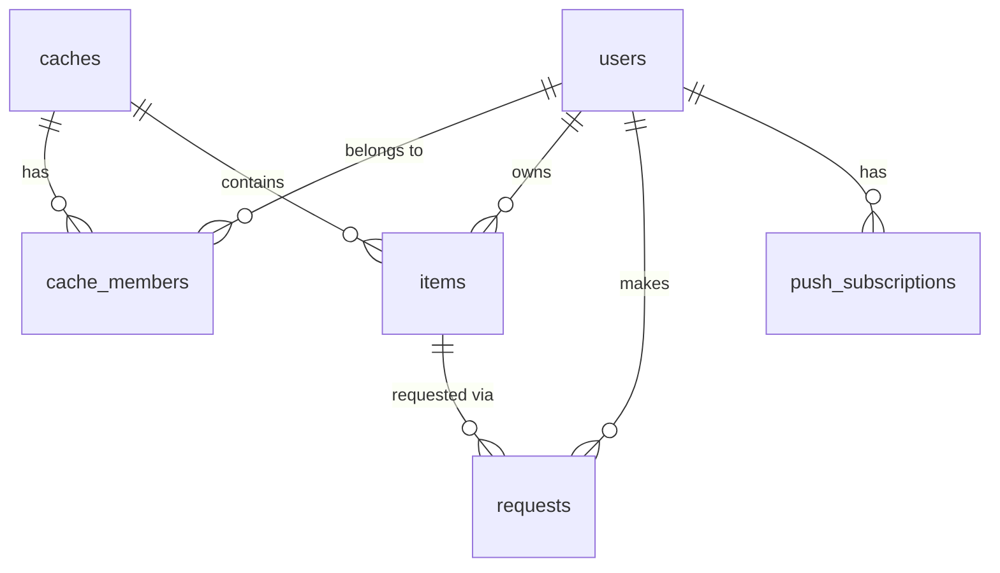

# Communal Cache MVP

## Scope decisions

- Email magic link only. No phone, no SMS.
- Web push for notifications, email via Resend as fallback.
- No return tracking, no holder tracking, no loan state. A request ends at `approved` or `rejected`.
- Non-consumables have no quantity. Only consumables do.
- Join by unguessable invite link. No password. Optional per-cache owner approval.
- One notification per request. No throttle.
- No addresses stored anywhere.

## Data model



Migrations in [migrations/](migrations/). Everything lives in an **`app` schema**, never `public`, for the Data API reason in Authorization below. Every table gets `id uuid PRIMARY KEY DEFAULT gen_random_uuid()` (except `cache_members`, keyed on the pair) and `created_at timestamptz NOT NULL DEFAULT now()`. Every foreign key and every status column is `NOT NULL` — a `CHECK (status IN (...))` passes on `NULL`, so the constraint is only real alongside `NOT NULL`.

- `users` — `id uuid PK` (equals Supabase `auth.users.id`, not generated), `email citext UNIQUE NOT NULL`, `display_name text` (nullable until onboarding; see below)
- `caches` — `name text NOT NULL`, `owner_id uuid NOT NULL REFERENCES users`, `invite_token text UNIQUE NOT NULL`, `requires_approval boolean NOT NULL DEFAULT false`
- `cache_members` — `PK (cache_id, user_id)`, both `NOT NULL REFERENCES ... ON DELETE CASCADE`, `status text NOT NULL CHECK (status IN ('active','pending','removed'))`. No `role` column: `caches.owner_id` is the single authority on ownership, and a second copy could disagree with it.
- `items` — `cache_id uuid NOT NULL REFERENCES caches ON DELETE CASCADE`, `owner_id uuid NOT NULL REFERENCES users`, `title text NOT NULL`, `description text`, `photo_path text`, `is_consumable boolean NOT NULL`, `quantity int`, with `CHECK (is_consumable = (quantity IS NOT NULL))` and `CHECK (quantity IS NULL OR quantity BETWEEN 0 AND 9999)`
- `requests` — `item_id uuid NOT NULL REFERENCES items ON DELETE CASCADE`, `requester_id uuid NOT NULL REFERENCES users`, `quantity int`, `status text NOT NULL CHECK (status IN ('pending','approved','rejected'))`, `decision_reason text`, `decided_at timestamptz`, plus:
  - `CHECK (quantity IS NULL OR quantity BETWEEN 1 AND 9999)`
  - `CHECK ((status = 'pending') = (decided_at IS NULL))`
  - `CHECK (status <> 'rejected' OR decision_reason IS NOT NULL)`
  - partial index on `(item_id) WHERE status = 'pending'` for the reservation sum
- `push_subscriptions` — `user_id uuid NOT NULL REFERENCES users ON DELETE CASCADE`, `endpoint text UNIQUE NOT NULL`, `p256dh text NOT NULL`, `auth text NOT NULL`
- `outbox` — `kind text NOT NULL`, `dedupe_key text NOT NULL`, `UNIQUE (kind, dedupe_key)`, `payload jsonb NOT NULL`, `attempts int NOT NULL DEFAULT 0`, `send_after timestamptz NOT NULL DEFAULT now()`, `sent_at timestamptz`, `failed_at timestamptz`

`is_consumable` is immutable after creation. Flipping it would strand `quantity` and every pending reservation counted against it, and nobody needs to convert a mixer into brown sugar.

### Display name onboarding

Magic-link signup yields only an email, so `display_name` cannot be populated at first login and starts `NULL`. Defaulting it to the email's local part would leak a fragment of everyone's email into the member list and pending queue, which contradicts the privacy stance. Instead: a `requireProfile` middleware returns `409 profile_incomplete`, which the SPA routes to a one-time "what should neighbors call you?" screen.

The gate covers only the writes that expose you to other people — cache, item, and request mutations. `PATCH /api/me` and the push subscription routes are **exempt**, or the gate deadlocks: setting a display name is itself a write, so gating it would leave a new user with no way out.

### The over-booking guard

The only non-trivial invariant. For a consumable:

`available = items.quantity - COALESCE(SUM(requests.quantity) WHERE status = 'pending', 0)`

Three paths mutate it — create request, decide request, edit quantity — and all three run the same shape in a `READ COMMITTED` transaction (Postgres default, deliberately not `REPEATABLE READ`, which would abort with a serialization error instead of blocking):

1. `SELECT ... FROM items WHERE id = $1 FOR UPDATE` — serializes all three paths on the item row.
2. Read the pending sum in a _separate statement_ after the lock is acquired. Under `READ COMMITTED` this sees what the previous lock holder committed; under `REPEATABLE READ` it would still see the stale snapshot.
3. Mutate, checking the invariant.

Per path:

- **Create**: `quantity` must be `NULL` for a non-consumable and a positive int within bounds for a consumable — a cross-table rule no `CHECK` can express, so the handler enforces it and a test covers both directions. Reject with 409 if `quantity > available`.
- **Approve**: `UPDATE requests SET status='approved', decided_at=now() WHERE id=$1 AND status='pending'`. Zero rows changed means someone already decided it — roll back with 409. This is what stops a racing double-approval from deducting twice. Then `items.quantity -= request.quantity`. Net effect on `available` is zero: the reservation became a real deduction.
- **Reject**: same guarded `UPDATE`, `decision_reason` required. The reservation is released by leaving the pending sum.
- **Edit quantity**: floor the new value at the current pending sum, rejecting with 409 below it. Restocking upward is unconstrained.

## Authorization

### Closing the Supabase Data API first

Supabase serves a PostgREST Data API reachable with the **anon key** — which this app deliberately hands to every browser from `GET /api/config` so the SPA can talk to Supabase Auth. Tables sitting in `public` with RLS off are therefore readable and writable by anyone who opens devtools, which would route around every check below. Nothing else in this section means anything until that door is shut, and it closes in four independent places:

- **Disable the Data API for the project entirely.** This app never uses PostgREST — the browser talks only to the Go API, and Supabase is here for Auth and Storage, which are separate services and unaffected. Removing the surface beats guarding it.
- Application tables live in an **`app` schema**, not `public`, and `app` is never added to the exposed-schemas list. PostgREST cannot serve what is not exposed.
- `REVOKE ALL ON SCHEMA app FROM anon, authenticated`, and revoke default privileges too, so a later table inherits nothing.
- `ALTER TABLE ... ENABLE ROW LEVEL SECURITY` on every table with **zero policies**. RLS default-denies, so this is a deny-all wall against any role that does reach the tables.

Four controls for one boundary is more than this app's size would normally justify, but each is one line and the failure mode is the entire database, including every member's email and every invite token.

That last point is not a reversal of the RLS tradeoff below: this is RLS as an outer wall with no policies to write or maintain, not RLS as the authorization mechanism. Nothing needs to plumb a per-request user identity into Postgres.

Go reaches the tables because **the role in `DATABASE_URL` owns them** — migrations create the `app` schema as that role, and a table's owner is exempt from its own RLS. The corollary matters: `FORCE ROW LEVEL SECURITY` must never be set on these tables, since that removes the owner exemption and would deny the application through its own wall.

### The storage bucket is the same boundary

Supabase Storage authorizes with RLS policies on `storage.objects`, so the analogous exposure is a bucket that anon can list or download. The bucket is private and gets **no policies at all**, which leaves the service role — server-side only — as the sole accessor. Go uploads with the service key and hands out short-lived signed URLs; the service key never appears in `GET /api/config` or any other browser-reachable response.

### Application checks

Every cache-scoped query resolves membership _in the same SQL statement_ as the data fetch, joining `cache_members` on `status='active'` — never as a separate pre-check, which is what lets a direct-ID route drift out of scope. Failures return **404, not 403**, so a non-member cannot probe for existence.

Policy per route:

- Active member of the cache: `GET /api/caches/{id}` (including `invite_token`, since the user wants any member able to share it, and the member list), `GET /api/caches/{id}/items`, `GET /api/items/{id}` and its pending queue, `POST /api/caches/{id}/items` (with `owner_id` taken from the caller, never from the body)
- Item owner only: `PATCH`/`DELETE /api/items/{id}`, `POST /api/items/{id}/photo`, `POST /api/requests/{id}/approve|reject`
- Active member, excluding the item's own owner: `POST /api/items/{id}/requests`
- Cache owner only (`caches.owner_id = caller`): `PATCH /api/caches/{id}` (name, `requires_approval`), `POST /api/caches/{id}/invite/rotate`, join-request decisions, `DELETE /api/caches/{id}/members/{userId}`
- Authenticated user, scoped by construction with `WHERE user_id = $auth`: push subscription routes, `GET /api/requests`

`POST /api/caches` inserts the cache and its owner's `active` membership row in one transaction. Otherwise the creator is not a member and cannot see the cache they just made.

The pending queue is the one deliberate disclosure: it returns requester `display_name`, quantity, and `created_at` to every active member, because the user specified a publicly visible queue. Decided requests stay visible only to the requester and the item owner.

Member and queue payloads do carry `user_id` and `request_id` — the client needs them to key rows and to address `DELETE /api/caches/{id}/members/{userId}` — but **never `email`**. Emails appear in exactly one response, `GET /api/me`, and only your own.

Member removal takes effect on the next request even though the removed member still holds a valid JWT, because authorization is a live `cache_members` lookup rather than a claim in the token.

## Membership lifecycle

- **Join** `POST /api/join/{token}`: inserts `active`, or `pending` when `requires_approval`. A `removed` row is left untouched and returns 403 — otherwise removal is meaningless, since the invite link is still sitting in the group chat.
- **Join rejected**: the `pending` row is deleted rather than marked `removed`, so a mistaken rejection can be redone.
- **Cache owner** cannot be removed and cannot remove themselves. Ownership transfer is out of scope, so the owner leaving is not a supported flow.
- **Removing a member** is one transaction that locks their `cache_members` row `FOR UPDATE`, sets `status='removed'`, deletes their items in that cache, and rejects the still-pending requests _they_ made against other people's items with reason "left the cache". To close the race where they create a request while being removed, membership resolution on write paths takes `FOR SHARE` on the same member row, so the two cannot interleave.

The cascade needs the requests table and the outbox, so it cannot be built alongside caches. That makes the **destructive endpoints themselves late work**: `DELETE /api/caches/{id}/members/{userId}` and `DELETE /api/items/{id}` ship together with their cascades, not before. Exposing removal earlier would leave a deployable build — and every phase here deploys — where removing someone strands their items in the cache and where deleting an item erases requests with nobody told. Shipping the endpoint with the invariant it depends on avoids writing transitional cleanup that gets deleted a phase later.

### What deletion does to requests

Two different mechanisms, and the distinction matters because only one can show a reason:

- **An item is deleted** (directly, or because its owner was removed): its requests go with it via `ON DELETE CASCADE`. There is no surviving row to display a rejection reason on, so the notification carries the whole story — it embeds the item title and says the item was removed. Enqueued in the same transaction as the delete.
- **A member is removed**: the requests they made against _surviving_ items are rejected, not deleted. The row survives, so `decision_reason` is visible to both parties in the normal way.

### Both destructive paths must lock items first

Every affected item row is locked `FOR UPDATE`, in ascending `id` order, **before** anything reads the pending requests it is about to destroy or decide. Skipping that loses a request silently: the delete snapshots the pending list, a member concurrently creates a request — their create takes the item lock, commits, and returns them a `201` — and then the cascade erases it, with no notification because the snapshot predated the insert. Taking the lock first forces that create to either land before the snapshot, and so be included, or block until the item is gone and fail with a `404` the requester actually sees.

The set to lock is not only the items being deleted. Member removal also rejects the requests that member made against _other people's_ items, and a rejection is a decision, which the over-booking guard requires the item lock for. So removal locks the union: their own items in that cache, plus every item they hold a pending request against.

### One lock order, everywhere

Any path taking both kinds of lock takes them in this order, without exception:

1. The `cache_members` row — `FOR SHARE` on write paths resolving membership, `FOR UPDATE` on removal.
2. Item rows, ascending by `id`.

This is the whole deadlock story, and it is easy to get wrong: removal naturally reaches for the membership row first, while creating a request naturally reaches for the item first and checks membership after. Those two orders deadlock against each other under concurrency. Membership before items, items in `id` order, is the rule that makes two removals, a removal racing a deletion, and a removal racing a request all safe.

## Backend

Single Go binary in [cmd/server/main.go](cmd/server/main.go), `net/http` with stdlib `ServeMux` method+wildcard patterns. No router library.

- `internal/db` — `pgx` pool, hand-written SQL. The single authorization chokepoint described above.
- `internal/auth` — JWT validation via `github.com/lestrrat-go/jwx/v3` (crypto is not something to hand-roll; jwx covers both JWS verification and a caching JWKS fetcher). Requires Supabase **asymmetric** signing keys so no shared secret reaches Go. Accepts an explicit `alg` allowlist of exactly `ES256` and `RS256` matched against the JWK's own `alg` — not merely inferred from key type, which would still admit weaker algorithms sharing that type — and rejects `none` and HS256 confusion. Validates `iss` = `{SUPABASE_URL}/auth/v1`, `aud` = `authenticated`, and `exp`. Unknown `kid` triggers one rate-limited JWKS refetch for key rotation. Upserts the `users` row from `sub` and `email`.
- `internal/api` — handlers, one file per resource.
- `internal/notify` — web push via `webpush-go` (RFC 8291 payload encryption; no stdlib equivalent), Resend via a plain `net/http` POST (no SDK). Email bodies render through `html/template`, which escapes interpolated values — item titles and rejection reasons are user input landing in HTML.
- `internal/outbox` — see below.
- Migrations run at boot from an `embed.FS`, each in its own transaction, recorded in `schema_migrations`, and the whole run wrapped in `pg_advisory_lock` — Fly overlaps old and new machines during a rolling deploy, so two processes will otherwise migrate concurrently. Advisory locks are session-scoped, so the lock and every migration must run on **one dedicated connection** held for the whole run, not on the pool; taken from the pool, the lock would sit on a different connection than the migrations and protect nothing.

`DATABASE_URL` must therefore be a **direct connection or Supavisor session mode, never transaction mode** (port 6543). Transaction pooling multiplexes connections per transaction, so a session-scoped advisory lock stops being a mutex — the migration race, defeated one layer below the code that guards against it. Transaction mode also breaks pgx's prepared-statement cache. If someone later needs transaction pooling, the migration runner has to move to `pg_advisory_xact_lock` inside a single transaction wrapping the whole run, and pgx has to be put in simple-protocol mode.

### Input validation

At the boundary, before anything reaches Postgres: `http.MaxBytesReader` caps JSON bodies at 16KB and photo uploads at 5MB; `title` 120 chars, `description` 2000, `display_name` 60, `decision_reason` 500; required text is trimmed and rejected if empty; `quantity` bounded 1–9999 matching the `CHECK`. Length limits are enforced in Go rather than as `varchar(n)` so the error is a 400 with a field name instead of a 500.

### Notification delivery

Delivery is **at-least-once, not exactly-once** — that is unachievable against an external push service, because a crash between "the provider accepted" and "we recorded it" is indistinguishable from a crash before the send. Duplicate notifications are the acceptable failure mode here; a missed one is not.

The worker leases rather than holding a transaction open across network I/O:

1. Claim, committed immediately:

```sql
UPDATE outbox SET attempts = attempts + 1,
       send_after = now() + least(interval '90 seconds' * power(2, attempts), interval '1 hour')
WHERE id IN (
  SELECT id FROM outbox
  WHERE sent_at IS NULL AND failed_at IS NULL AND send_after <= now()
  ORDER BY id FOR UPDATE SKIP LOCKED LIMIT 10
) RETURNING *
```

2. Send outside the transaction, under a single 30s context covering the whole row. The claimed batch is processed **concurrently**, one goroutine per row: ten rows handled sequentially at up to 30s each is 300s, which blows past the 90s lease and invites another worker to re-claim the tail of the batch. Concurrently, the batch's wall time is its slowest row, so the invariant is 30s < 90s regardless of batch size.
3. On success `UPDATE ... SET sent_at = now() WHERE id = $1 AND sent_at IS NULL AND failed_at IS NULL`. On an _observed_ failure at `attempts >= 6`, set `failed_at` the same guarded way and log — that is the dead letter. Otherwise do nothing and let the row become claimable again once `send_after` passes.

Both terminal writes carry that `AND sent_at IS NULL AND failed_at IS NULL` guard because a worker whose lease expired mid-send is still running: another worker may have already claimed and delivered the row, and the straggler must not then stamp `failed_at` on a message that actually went out.

`send_after` does double duty as the lease deadline and the backoff timer, which is why the interval is computed from `attempts`. The `SET` expressions see the row's pre-update values, so the first claim leases for 90s, then 3m, 6m, 12m, capped at an hour.

**The 30s row context is what keeps a send inside its lease, and per-call timeouts alone are not enough.** A recipient with three subscriptions plus an email fallback is four sequential calls; at 10s each that is 40s, which would overrun a shorter lease and invite a second worker to duplicate the send. One deadline for the whole row, comfortably under the 90s minimum lease, is the bound that actually holds — the per-call 10s timeouts just stop any single hung provider from eating the whole budget.

**Eligibility is bounded by `failed_at`, deliberately not by `attempts`.** Bounding the claim predicate on `attempts` instead looks tidier but is broken: the claim increments `attempts`, so the last permitted claim would make the row ineligible _before its send was even attempted_, and a crash during that send would lose the notification permanently, having never delivered it once. Because the terminal marker is only ever written after an observed failure, a crash costs an extra retry rather than the message.

`attempts` is consequently a **claim budget, not a failure budget**: a crash consumes one, so a row can reach the `attempts >= 6` give-up threshold with fewer than six observed failures. That is the intended reading — six attempts of any kind is enough — and the test asserts it rather than assuming six failures.

Channel choice is **structural, not a retry ladder**: a recipient gets email if and only if they have no live push subscription — none registered, or every one of them answered `404`/`410` during this attempt, in which case those rows are deleted and email goes out in the same pass. There is deliberately no "push kept failing, so escalate to email" path. That ladder was the source of a bug in three consecutive review rounds, because it made the escalation threshold and the give-up threshold interact, and it needed a second counter to separate claims from observed failures. Deleting it removes the counter, the interaction, and two test cases. `ponytail:` the ceiling is that a single notification is missed if someone's push endpoint returns transient errors for the entire retry window; the upgrade path is to reinstate escalation with an explicit `failures` column distinct from `attempts`. The queue is visible in the app regardless, so a notification is an accelerant rather than the only route to seeing a request.

### Who gets notified

- Request created — the item's owner
- Request approved or rejected — the requester
- Item deleted — everyone with a pending request on it
- Member removed — the requesters whose requests were rejected as a result
- Join request created on an approval-gated cache — the cache owner
- Join request approved or rejected — the person who asked

Outbox rows are inserted in the same transaction as the state change they describe, so a rolled-back mutation enqueues nothing.

The `outbox` table and every enqueue therefore land in the phase that creates the event, not the phase that delivers it. The table ships with the first migration and join approvals and request decisions enqueue as soon as those features exist, even though the worker only arrives later. Otherwise the intermediate deploys drop events on the floor with no record, and the enqueue calls have to be retrofitted into handlers that were already written and reviewed.

### Push endpoints are untrusted input

`POST /api/push/subscribe` takes an endpoint URL from the browser, and the worker later POSTs to it from inside Fly's network — where the cloud metadata endpoint and 6PN private addresses are reachable. Left unchecked that is a straightforward SSRF: an authenticated user stores `http://169.254.169.254/...` and has the server fetch it. Three controls, all on the subscribe path and the push client:

- Origin allowlist of the real push services — `fcm.googleapis.com`, `updates.push.services.mozilla.com`, `web.push.apple.com`, `*.notify.windows.com` — rejecting anything else at subscribe time. This is the control that actually matters; the rest are depth.
- HTTPS only, no userinfo in the URL.
- The push HTTP client refuses redirects and, after DNS resolution, refuses to dial any non-public IP, which closes rebinding against the allowlist.
- Outbound push and Resend calls both get a 10s client timeout, inside the 30s per-row deadline described above.

### Endpoints belong to browsers, not accounts

A push endpoint identifies a browser installation, not a person, so on a shared iPad — or after one housemate logs out and another logs in — the same endpoint arrives under a second account. Because `endpoint` is `UNIQUE`, subscribing must reassign rather than conflict:

```sql
INSERT INTO app.push_subscriptions (user_id, endpoint, p256dh, auth) VALUES (...)
ON CONFLICT (endpoint) DO UPDATE
  SET user_id = EXCLUDED.user_id, p256dh = EXCLUDED.p256dh, auth = EXCLUDED.auth
```

Silently ignoring the conflict instead would leave the endpoint owned by whoever subscribed first, and that device would then receive the previous account's notifications. Logging out issues `DELETE /api/push/subscribe` for the endpoint.

### Routes

- `GET /api/config` — `SUPABASE_URL`, anon key, VAPID public key, served at runtime so the Docker build needs no secrets
- `GET /api/healthz`
- `GET/PATCH /api/me`
- `GET/POST /api/caches`, `GET/PATCH /api/caches/{id}`, `POST /api/caches/{id}/invite/rotate`
- `POST /api/join/{token}`
- `GET /api/caches/{id}/join-requests`, `POST .../{userId}/approve|reject`
- `DELETE /api/caches/{id}/members/{userId}`
- `GET/POST /api/caches/{id}/items`, `GET/PATCH/DELETE /api/items/{id}`, `POST /api/items/{id}/photo`
- `POST /api/items/{id}/requests`
- `POST /api/requests/{id}/approve`, `POST /api/requests/{id}/reject`
- `GET /api/requests` — incoming and outgoing
- `POST/DELETE /api/push/subscribe`

## Frontend

React + TypeScript + Vite in [web/](web/), built into the Go binary via `embed`. react-router for invite deep links, TanStack Query, Tailwind. Mobile-first, bottom nav.

Screens: login, display-name onboarding, dashboard (my caches, create, join), cache view (item list, members sheet), item detail sheet with "Ask to use", add item form, requests screen, join-via-link.

**Invite through login.** The primary onboarding path is a logged-out user tapping an invite link, so the token has to survive the magic-link round trip: `/join/:token` stashes the token in `sessionStorage` and passes `emailRedirectTo = {APP_BASE_URL}/join/{token}`, and Supabase's redirect allowlist must include that wildcard path or the link bounces.

**Photos.** Resize to max 1600px and re-encode to JPEG on a `<canvas>` before upload, which keeps every image library out of Go and sidesteps HEIC because the browser already decoded it. That decode is not guaranteed, though — an unsupported format or a large image on a low-memory device can fail, and `toBlob` can hand back `null`. Both cases surface a "couldn't read that image, try another" message rather than uploading a blank frame. Go still validates at the boundary: sniff the content type, cap the body, reject anything but JPEG/PNG/WebP. Item lists get batched signed URLs from a private Supabase Storage bucket, 1-hour TTL.

**Push.** Service worker plus PWA manifest. iOS has no programmable install prompt — no `beforeinstallprompt` — so iOS Safari gets rendered instructions ("Share, then Add to Home Screen") and nothing more. `Notification.requestPermission()` is called only from an explicit user gesture, and on iOS only inside the installed PWA, which is the only context there that can receive push.

## Checks

Tests land with the feature that needs them, not in a phase at the end. Everything touching concurrency, constraints, or migrations runs against a real Postgres from `TEST_DATABASE_URL` (a `docker run postgres` make target), never a mock — the invariants under test are enforced by Postgres itself.

The harness has to `CREATE ROLE anon` and `CREATE ROLE authenticated` before migrating. Vanilla Postgres has neither, they exist only because Supabase provisions them, and `REVOKE ALL ON SCHEMA app FROM anon` fails outright on a role that does not exist — so without this the very first migration dies locally while working fine in production. Creating them also makes the local database a closer match for the boundary assertions below.

- **Requests**: concurrent creates never let pending exceed available; concurrent approves of the same request deduct exactly once; approve-after-reject returns 409; a restock racing a create loses neither write; quantity is rejected when supplied for a non-consumable and when omitted for a consumable.
- **Authorization**: a matrix over non-member, pending member, removed member, active member, item owner, and cache owner across every direct-ID route, asserting 404 for cross-cache access. Plus: creating an item cannot forge `owner_id`; creating a cache leaves the creator an active member.
- **Membership**: removal deletes their items and rejects their outstanding requests; a request created concurrently with removal cannot land; a removed member cannot rejoin with a valid token; the cache owner cannot be removed.
- **Profile gate**: cache, item, and request writes return `409 profile_incomplete` before `display_name` is set, while `PATCH /api/me` succeeds — the test that would have caught the deadlock.
- **Uploads**: oversize body, wrong content type, and an SVG with a script are all rejected.
- **JWT**: wrong `iss`, wrong `aud`, expired, `alg=none`, HS256 signed with the public key, an `alg` outside the allowlist, and unknown `kid` are all rejected; rotation succeeds after one refetch.
- **Outbox**: a kill mid-send loses nothing (a duplicate is acceptable and expected); a kill immediately after the sixth claim still leaves the row claimable — the test that would have caught the `attempts`-bounded predicate defect; six claims of mixed crashes and observed failures reach the give-up threshold, pinning the claim-budget reading; a recipient with no subscriptions gets email; a `410` deletes the subscription and emails in the same pass; a permanently failing send sets `failed_at` and stops being claimed; a straggler whose lease already expired cannot stamp `failed_at` over another worker's `sent_at`. Recipients are asserted per event: creation notifies the owner, decisions notify the requester, item deletion notifies its pending requesters, and a rolled-back mutation enqueues nothing.
- **Destructive races**: creating a request concurrently with a direct item deletion, and with removal of the item's owner, each end in one of exactly two states — the create fails with 404, or it succeeds and its notification outbox row exists. Never success with the request silently gone.
- **Push endpoints**: `169.254.169.254`, `localhost`, a `.internal` host, a plain-HTTP URL, and an off-allowlist origin are all rejected at subscribe time, while genuine Apple, Mozilla, and FCM endpoints are accepted. Subscribing the same endpoint as a second user reassigns it, and the first user then receives nothing on it.
- **SSRF at dial time**, which the subscribe-time cases above do not reach: an allowlisted hostname that _resolves_ to a private address is refused when dialed, covering DNS rebinding past the origin check, and an endpoint answering `302` toward an internal address has the redirect refused.
- **Data API boundary**: this is the test for the one defect that would have made every other check in this plan decorative, so it goes over **HTTP against PostgREST with a real anon key and a real signed-in user's token** — not by `SET ROLE` in a database session, which exercises grants while proving nothing about the exposed-schemas config or the API gateway in front of it. The table list is read from `information_schema` at runtime rather than hardcoded, so a table added later without RLS fails this test instead of slipping through. Each of the four layers is then asserted **independently**, because a single end-to-end "anon gets nothing" check passes just as happily when three of them have quietly stopped working: `has_schema_privilege` shows the grants revoked, `pg_policies` is empty for every `app` table, `relrowsecurity` is set on each, and `relforcerowsecurity` is _false_ — that last one being the corollary that would otherwise lock the application out through its own wall.
- **Storage boundary**: an anonymous and an authenticated client can neither list the bucket nor download a known object path, while server-side upload succeeds and a signed URL resolves.
- **Onboarding end to end**: a logged-out invite link survives the magic link, lands on the display-name screen, and resumes the join afterward. The three mechanisms involved (the stashed token, the profile gate, the join) each work alone and are only interesting in combination.

**Completion gates** before each phase is called done: `go test ./...`, `go vet ./...`, `tsc --noEmit`, `vite build`, migrations apply cleanly to an empty database, and the Docker image builds and serves `/api/healthz`. Accessibility is on the not-lazy list, so the polish phase also checks labeled form controls, visible focus, keyboard-reachable modals and sheets, and text contrast.

**Manual post-deploy smoke checklist**, none of which is cheaply automatable: a magic link arrives (which exercises Supabase's SMTP config), a _notification_ email arrives (a separate path — the Resend API called directly from Go — so the magic link passing proves nothing about it), a signed image URL renders, push arrives on an installed iOS PWA, and a Fly rolling deploy with a pending migration comes up clean.

## Deployment

Multi-stage Dockerfile (node build, then go build with embedded `dist`), one Fly machine with `min_machines_running = 1` so the outbox worker actually runs, `/api/healthz` check.

Secrets: `DATABASE_URL`, `SUPABASE_URL`, `SUPABASE_ANON_KEY`, `SUPABASE_SERVICE_ROLE_KEY`, `RESEND_API_KEY`, `EMAIL_FROM`, `VAPID_PUBLIC_KEY`, `VAPID_PRIVATE_KEY`, `APP_BASE_URL`.

One-time setup, without which auth or email silently fails in production:

- **Resend**: verify the sending domain by publishing its SPF and DKIM records. Resend refuses to send from an unverified domain, and `EMAIL_FROM` must be an address on it.
- **Supabase**: disable the Data API; enable asymmetric JWT signing keys; configure Resend as **custom SMTP** (the built-in sender is rate-limited to a handful of emails an hour and is not for production); set Site URL and add `{APP_BASE_URL}/join/*` to the redirect allowlist; create the private storage bucket with no `storage.objects` policies.
- **`DATABASE_URL`**: direct connection or Supavisor **session** mode. Not port 6543 — transaction pooling breaks the migration advisory lock and pgx's prepared statements, as described above.

Note that the two email paths are independent: magic links go out through Supabase's SMTP configuration, while notifications call the Resend API directly from Go. Both need the verified domain, but each can fail on its own.

## Known tradeoffs

- **RLS is a wall, not the authorization model.** It is enabled with zero policies to deny any role that reaches the tables, but it does not distinguish between users — Go does. So a missing `WHERE` in Go still leaks across caches. Compensated by resolving membership inside every data query and by the authorization matrix test. Upgrade path is real per-user policies with transaction-local `app.user_id`.
- **Invite link is a bearer secret.** Forwarding it grants access. Compensated by high entropy, owner rotation, the approval toggle, and removal being independent of the token.
- **At-least-once notifications.** A duplicate push is possible after a crash mid-send. Chosen over the alternative, which is losing one.
- **No email escalation for transient push failures.** Email is for people without a working subscription, not a fallback for a flaky one. A notification can be missed if a push endpoint errors transiently across the whole retry window; the app's own queue view is the backstop.
- **Deleting an item erases its request history.** Acceptable because this app keeps no audit trail by design, and the affected requesters are notified.
- **No token revocation.** A signed-out user's JWT stays valid until `exp` (Supabase default one hour). Membership changes are unaffected, being live lookups.
- **Always-on machine** costs a few dollars a month; auto-stop would delay notifications until traffic wakes the worker.
- **Single item-row lock** serializes all quantity mutations per item. Fine at neighborhood scale; the ceiling is contention on one very popular consumable.
