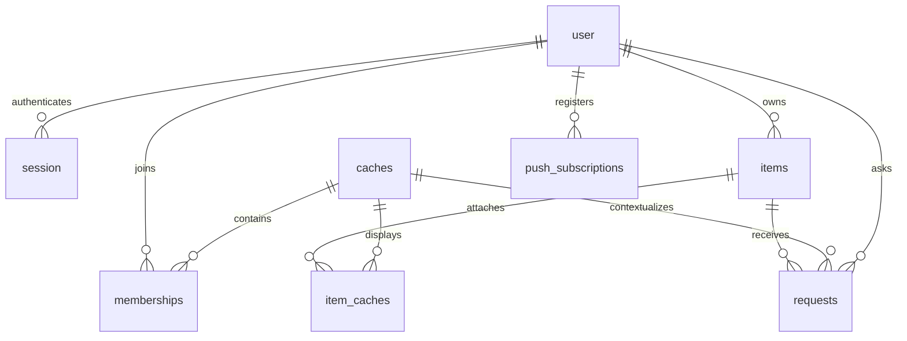

# Communal Cache MVP

## Scope and architecture decision

Mobile-first sharing for a close community: a directory and lightweight ask/approve
handshake, not logistics. Handoffs happen in real life; no addresses stored.

- Sign in primarily with an email containing **only a magic link**. “Email me a
  code instead” explicitly sends a separate six-digit code email. No password,
  combined link+code lifecycle or phone/SMS in scope.
- Web push for notifications; Resend email iff no live push subscription remains.
  One notification per request event; no notification throttle.
- One item is owned by one user and may be attached to many caches, or none.
  ONE canonical stock count and pending reservation sum serve every cache.
- Non-consumables have NULL quantity; only consumables have stock.
- **Lent out** is a manual owner availability flag plus optional note (max 200
  Unicode code points), shared across caches. A reusable approval offers **Mark as
  lent out**. It blocks new requests, not existing pending ones. No holder, return,
  due date, borrower assignment or loan lifecycle; requests end approved/rejected.
- Join by unguessable invite link; optional per-cache owner approval. Removed
  members cannot rejoin with the still-valid secret. Non-owner members may leave
  voluntarily and rejoin with a current invite, subject to approval; old items are
  not re-attached automatically. No ownership transfer.
- Private photos use immutable `ownerId/itemId/uploadUUID` keys in R2.

**Single-D1 decision:** one D1 database is the source of truth for all relational
app data, including notification outbox. Caches are no longer self-contained:
items appear in many caches and Home/Requests span caches. Writes are rare; the
Cache/Owner split imposed projections, discovery copies, target registration,
tombstones and alarm/sync recovery without a product need for that split.

This supersedes **PR #29's Owner-DO-per-user architecture**, retaining all the
product decisions above. Neither Cache nor Owner DOs are in the target. Drop
`pending_sync`, DO alarms, registry/my_caches/request_index/listings/owner_targets
copies and revocation tombstones. Notifications and R2 still need durable external
work, not a cross-store transaction.

PRs 2–6 implement the single-D1 routes/screens and real-SQL batch/race tests in
`src/db/`. Draft PR 7 removes historical Cache code/sweeps and prepares the
class-deletion config plus obsolete projection-table migration. **It is not
approved for merge/deploy: class deletion permanently destroys Cache DO data.**
The [build plan](build-guide.md#d1-implementation-plan) records review/release
status. Draft #28's cache fan-out library remains superseded by direct D1.
No remote migration, reset, class deletion or deployment is performed by the
retirement draft. Fly/Supabase stays live until separately approved cutover.

## Data model



All these tables plus outbox/cleanup intents live in **the same D1 database**.
No item, membership or stock copy lives elsewhere. R2 holds only private bytes;
Queue messages carry outbox IDs, not authoritative app state.

App keys are text UUIDs generated with `crypto.randomUUID()` before writes; app
identity is Better Auth `user.id` (`generateId: 'uuid'`). App timestamps are integer
Unix milliseconds. Auth columns/date conversions retain the reviewed pinned
schema. Booleans are SQLite 0/1 with CHECKs, nullable fields explicit; all SQL binds
input. [database.md](database.md) gives illustrative DDL and batch protocols.

| Table | Canonical content and constraints |
| --- | --- |
| Better Auth user/session/account/verification/rateLimit | Unchanged auth schema, private email, D1 sessions/challenges/rate limits; nullable app user.display_name |
| caches | UUID, name/config, 32-byte base64url join_secret, requires_approval, created_at; operation_token for guarded multi-statement mutations |
| memberships | (cache_id,user_id), role owner/member, status active/pending/removed/left, created_at, operation_token; exactly one active cache owner, protected from removal |
| items | UUID, owner_id, title, description, photo_path, immutable is_consumable, quantity, available, unavailable_note, created_at, operation_token |
| item_caches | Unique (item_id,cache_id), attached_at, operation_token; real FKs to items/caches, no duplicated stock/display fields |
| requests | UUID, item_id, cache_id where asked, requester_id, quantity, status, decision_reason, decided_at, created_at, decision_token |
| outbox | Existing stable id, kind/dedupe_key uniqueness, validated JSON payload, attempts, claim_token/claim_until, sent_at/failed_at, created_at |
| push_subscriptions | Existing user ownership, unique endpoint, keys, registration ID/version and creation time |
| r2_cleanup | Durable exact-key/prefix cleanup intent, stable ID, created_at and guarded expiring claim; Cron retries until completed |
| write_limits / notification_sync_cursor | Existing reusable per-user route counters and bounded outbox rescue cursor; add cleanup cursor/progress as needed |

Port existing checks: consumable quantity integer 0–9999 and non-consumable NULL;
request quantity NULL or integer 1–9999 with type consistency enforced by guarded
request SQL; status pending/approved/rejected, pending iff decided_at NULL, rejected
requires reason; roles/statuses and booleans constrained. `available` is the manual
flag, **not** calculated reservable stock. Notes have max 200 Unicode code points,
including server validation; title 120, description 2000, display name 60, reason
500. Trim text and return field-specific 400s, not raw constraint failures.

`requests` does not FK to `item_caches`: detach rejects pending rows but may retain
decided party history. Item deletion snapshots recipients before cascading item
requests. Auth email is not duplicated into app identity; public name enrichment
selects only user ID/display_name. Cache-owner and item-owner are different roles.

## D1 atomic writes and shared stock

### Platform boundary

The documented D1 binding has **no interactive JS transaction**. `batch()` runs
statements atomically; a failure “rolls back the entire sequence.” Each database
“processes queries one at a time” ([binding](https://developers.cloudflare.com/d1/worker-api/d1-database/index.md#batch),
[limits](https://developers.cloudflare.com/d1/platform/limits/index.md)). These are
VERIFIED platform facts, not proof of our not-yet-written SQL.

Every authorization/stock check and write must be:

1. **One guarded statement**, e.g. `INSERT ... SELECT ... WHERE` or `UPDATE ...
   WHERE`, or
2. **One atomic batch** whose primary guarded write sets a fresh, server-generated
   per-operation token. Every dependent statement requires the exact token from
   that operation. A zero-row primary must make every dependent statement no-op.

Never perform a SELECT, await, then write based on that earlier authorization or
stock read. A diagnostic SELECT after a failed write can classify the response,
not authorize a retry. Read primary D1 `meta.changes` to choose success vs 404/409:
no authorized resource is 404; an authorized losing stock/pending-state race is
409. If removal races error classification, prefer 404 over existence disclosure.
Invalid types/ranges are 400. SQL `changes()` carrying across batch statements is
**UNVERIFIED and forbidden**. Returned meta.changes is not that SQL function.

Tokens are operation witnesses, not browser capabilities, wall-clock ordering or
cached membership grants. Generate a new UUID per attempt, never reuse a prior
successful token. `decision_token` belongs to requests; `operation_token` on a
cache/member/item/attachment supports batches that delete their source row last.
All token predicates include the target IDs; no unrelated row may satisfy them.
A failed constraint rolls back; **zero affected rows is not failure**. Ensure the
primary guard and FK/schema invariants imply dependent stock/state writes can
succeed, or cause an actual SQL error to abort the batch; a JS check after commit
cannot roll it back. Do not rely on a later guarded no-op to undo approval.

### Request creation

For item I, across **ALL caches**:

`available_quantity = items.quantity - COALESCE(SUM(requests.quantity) WHERE item_id = I AND status = 'pending', 0)`

No cache_id filter belongs in that reservation sum. Request creation's primary
`INSERT ... SELECT` joins/existence-checks:

- requester and item owner are active members of cache C;
- item I exists and is attached to C;
- caller/requester differs from owner (body-supplied requester/owner is rejected);
- reusable quantity NULL, or consumable integer 1–9999;
- manual `available = 1`;
- consumable stock minus all pending reservations is at least requested quantity.

In the **same batch**, insert request-created outbox via the newly generated
request UUID (which serves as the creation witness). A duplicate primary UUID must
fail, not `OR IGNORE` and reuse an older row to manufacture another effect. Two
caches competing for an item use this one guarded reservation sum. No D1 copy or
DO admission step precedes it. Reusable requests have no stock subtraction.

### Approve, reject and edit

Illustrative approval shape (each line represents bound SQL in ONE batch):

```text
UPDATE requests SET status='approved', decided_at=now, decision_token=fresh
  WHERE id=R AND status='pending' AND item belongs to caller
    AND requester/owner memberships active AND attachment exists
    AND consumable stock can cover R;
UPDATE items SET quantity=quantity-R.quantity
  WHERE consumable AND EXISTS(request R with decision_token=fresh);
UPDATE items SET available=0, unavailable_note=note
  WHERE reusable AND checkbox_checked AND EXISTS(R with decision_token=fresh);
INSERT outbox ... SELECT snapshot FROM R/item/cache WHERE R.decision_token=fresh;
```

Pending-only transition is the primary statement. The token makes a concurrent
second approve/reject a complete no-op, with primary meta.changes zero → 409 for
an authorized caller. CHECK failure in a stock deduction aborts the entire batch;
never silently skip deduction after setting approved. Required relationships and
stock predicates are verified by real-SQL tests. Rejection uses the same pending/
party/membership/attachment guards, a required reason, no deduction, and an outbox
snapshot. Already decided requests are not reversed by later removal.

Manual Lent out blocks **new** requests only. Existing pending rows remain
approvable/rejectable while their membership/attachment remains valid. Reusable
approval's checkbox sets flag/note atomically; unchecked approval does not clear
an existing flag. The owner marks available again manually. No listing intents.

Owner-only stock UPDATE includes `new_quantity >= all_pending_sum(item)` and range
checks in the guarded statement. Type is immutable. D1 serialization plus the
statement/batch boundaries close create/edit/decision races; handler scheduling or
isolate memory is not the lock.

## Authorization

D1/R2 bindings are server-only, not PostgREST/browser database APIs. Better Auth
provides same-origin cookies; no provider anon key or browser D1/R2 credential.
The target drops Postgres app schema/RLS/pooling, but **legacy protections stay**.

**Cache-data SELECTs and mutations check active membership in the same SQL
statement or atomic batch**, via joins/EXISTS, except the narrowly approved
pre-join invite preview below. No cached membership result, copied authorization,
token from another request or preliminary SELECT is sufficient. Cache item/photo
access also joins attachment and active item-owner membership. Pending/removed/
non-members get **404**, not 403; a valid-current-secret removed join or invite
preview retains the explicit **403** denial. Wrong cache/item/owner IDs get 404. Use the authenticated
caller for ownership, never a request-body owner. These are invariants 1–7 in
[AGENTS.md](../AGENTS.md#non-negotiable-invariants).

| Operation | Predicate in its SQL statement / guarded batch |
| --- | --- |
| Home / cache detail / members | Active caller membership; owner-only settings/invite rotation additionally require role=owner |
| Library create/read/edit/delete/photo | Authenticated item's owner_id; no cache needed; ownership/stock/cascade guard as appropriate |
| Attach item to C | Caller owns item AND active member of C; insert only canonical attachment |
| Detach item from C | Caller owns item AND active member of C; atomic pending rejection and attachment deletion |
| Cache items/detail/photo/pending queue | Active caller and item owner memberships AND item_caches row for C; queue restricts requests.cache_id=C |
| Request create / decision | All request/stock predicates above; decision also requires caller=item owner and pending state |
| Incoming/outgoing Requests | Direct item owner/requester filter; party-owned history only, never a grant to cache/item/photo data |
| Joining | Valid current secret and guarded membership transition; no existing active membership required |
| Pre-join invite preview | Authenticated caller + exact current secret + active cache owner in the same read; removed caller denied; only cache name, active count and bounded cat traits |

The cache pending queue deliberately exposes requester display name, quantity,
time, user_id/request_id to active members of **that cache only**. The all-cache
availability sum does not expose other caches' requester identities. Decided rows
are party-scoped. Party history may survive membership loss; cache details, photos,
queue access and new writes do not. No endpoint returns another user's
**authentication email**; `GET /api/me` and auth endpoints return only the caller's
own user/session email. The production-readiness contact feature below permits
only an explicitly chosen, separately stored contact email under its stricter
approved-request/current-membership visibility rule; never derive it from auth.

Home directly joins memberships/caches. Your items directly filters owner_id,
including unattached items. Incoming/outgoing Requests join items and filter owner/
requester, with stable cursor pagination; no cache/owner RPC fan-out or request_index.
Apply current membership again for every cache-context follow-on operation.
Name enrichment never selects email. Cache admins cannot edit another owner's item.

### Approved pre-join invite preview

**Owner-approved privacy exception (2026 chat: “Invite page before joining”).**
After sign-in, a valid current invite may reveal **only the cache name, exact
active member count and up to five active members' cat appearances** before the
caller joins. This is not public discovery or permission to read cache contents.
The UI completes name setup first, then shows **“An invite to <cache name>”** in
the small uppercase eyebrow, above member cats and a dashed YOU slot on the named
box. The count uses “neighbors”; the main heading remains **“There's room in the
box for you.”** and the greeting uses only the caller's own chosen name. It does
not show an inviter, member names, item/things count or approval/configuration
claim.

`GET /api/caches/{cacheId}/invite/preview` requires the same D1-backed cookie
identity as joining. Carry the secret in **`X-Invite-Secret`**, not an API path or
query string. One D1 statement checks the exact current secret and active owner,
counts active memberships and bounds the active-cat selection. A valid-current-
secret removed caller gets 403 `member_removed` with no preview fields; missing,
wrong-cache, malformed or rotated secrets get the same 404 `not_found` body as a
nonexistent cache. Responses are no-store; a previous preview does not authorize
another read or a later join. Already authorized reads are not recalled.

The response is `{name, active_member_count, members}`. Each member is only the
already-derived tuple **`{coat, pattern, folded, tip, delay}`**. Derive it from the
real user ID and chosen `cat_coat` with the same pure `shared/cats.ts` function the
signed-in app uses, so the cat looks identical before/after joining. Do not send
raw IDs, identity hashes/seeds, display/auth names, auth/contact emails, inviter/
owner identity, photos/photo metadata, item data/counts, requests or invite secret.
Count all active members (including the owner); pending/left/removed members are
not roof cats. Any `+N` is count minus the bounded visible cats, not a sample total.

This read creates no membership, reservation or notification. **Ask to join is
still explicit**, including active/pending replays, and the existing guarded POST
rechecks the current secret/configuration, removed denial and applicable quotas.
No auto-join/auto-redirect, profile-photo grant or cached permission is introduced.
Unauthenticated invite holders keep the existing saved-invite sign-in flow and
receive no preview metadata before authentication.

### Private photos

R2 has no public domain or r2.dev access. Cache photo reads use the D1 predicates
above before streaming with private, no-store headers. Library reads authenticate
the owner directly. Same-origin cookies work with ``; no signed URL or
bearer/blob route, no shared authorized-response cache.

Owner uploads first consume one shared per-user D1 abuse budget: **20 attempts
per fixed clock hour** across profile and item photos, before body reading/R2 put.
The guarded reusable counter follows the existing code-defined request/join abuse
budgets, not plan entitlements. Fixed-window boundaries can admit 40 attempts;
this is not a rolling-hour or total-storage cap. Over-budget requests get 429
`rate_limited`, stable `limit: 'photo_upload'` and Retry-After, with “Too many photo
uploads, try again later.” UI copy. Ordinary replacement stays allowed below the
budget; reads/removal and the post-I/O guards are unchanged.
Owner upload caps actual bytes at 5 MB, sniffs JPEG/PNG/WebP (never SVG), writes a
new ownerId/itemId/uploadUUID key, then **rechecks item/ownership in a guarded D1
finalization batch after R2 I/O**. Atomically replace photo_path and insert cleanup
for replaced/rejected keys. Retrying uncertain finalization must not delete the
currently attached key. Detach/member removal never deletes the canonical photo.
A crash after R2 put but before finalization can orphan bytes; this is a storage
leak, not an access grant. Durable pre-upload tracking/orphan sweeping is an
upgrade, not an invented D1/R2 atomic guarantee. Prefix cleanup on item deletion
and exact-key cleanup handle known work; document remaining crash coverage.

## Membership and destructive batches

- Join link is `cacheId.secret`; secret is 32 random bytes/base64url. The API is
  `POST /api/caches/{cacheId}/join` body `{secret}`, not a secret-bearing API path.
  Compare decoded fixed-length secrets in constant time in the Worker. The guarded
  D1 INSERT/UPDATE also matches the exact stored secret/version that was compared,
  and uses current requires_approval, closing rotation/config races. The secret
  read alone cannot authorize a later write. Missing cache/mismatch is 404.
- New membership is active or pending. Existing active/pending joins are idempotent;
  removed is never overwritten and returns 403 **only with a valid current secret**.
  A voluntary left membership is replaced by a fresh active/pending join under the
  current secret/approval setting, without restoring old attachments.
  Owner approval/rejection is a guarded batch with a token and outbox snapshot.
  Rejection deletes pending membership so retry is possible; removal retains it.
- Cache creation inserts config and active owner in one batch; partial creation
  cannot strand its owner. Home/detail read canonical D1 immediately after commit,
  without waiting for a discovery projection. Exactly one active cache owner;
  owner cannot leave/be removed. No ownership transfer.
- **Remove member R from C:** primary guarded membership UPDATE requires active
  cache-owner caller, active non-owner target; set removed and fresh operation
  token. In that same batch snapshot/notify all affected pending requests, reject
  R's pending via C, reject all pending through R-owned attachments in C, then
  detach R's items from C. Dedupe overlaps. Keep R's library/photos/other caches.
- **Leave C:** active non-owner caller uses the same guarded removal batch, setting
  membership to left instead of removed. Pending requests are rejected and their
  items detached from C; library/photos/other caches survive. Owners cannot leave.
  Left members get cache-data 404 but may rejoin with a current valid invite.
- **Detach I from C:** primary guarded attachment marker requires item-owner caller
  and active membership. Snapshot/notify pending via this attachment, reject them,
  then delete the token-marked attachment last. Keep item/stock/photo/other caches.
- **Global item delete:** primary item marker requires its authenticated owner;
  snapshot pending recipients across all caches into outbox, reject affected rows,
  record owner-scoped R2 exact/prefix cleanup, then delete item/dependents last.
  Notifications do not FK to deleted source rows. Global delete erases its request
  history by design; recipient snapshots survive.

Each operation is **one guarded atomic batch**, including every snapshot and
relational change, not paginated partial destructive commits. `INSERT ... SELECT`
snapshots produce per-request dedupe keys. Removal/detach tokens carry the primary
authorization through their own state changes in that batch only. A losing guard
produces no notification or cleanup. Batch size/row work must be measured; if a
large cascade cannot fit platform limits, fail safely and redesign explicitly,
not silently split the atomic invariant.

Removal is effective immediately at the next SQL statement: a racing request
commits first and is included in removal, or removal commits first and its guard
fails. The same applies to attach/detach/delete races. No registered targets,
revocation tombstones, registry recovery or eventual permission propagation.
Previously authorized in-flight reads and completed approvals are not recalled.
PR 5's approved voluntary leave is POST /api/caches/{cacheId}/leave, using the same
non-owner cleanup batch, never a bare membership delete. It retains a non-active
left membership so removed denial and voluntary rejoin remain distinct. Every
destructive endpoint ships only with its complete guarded batch/race proof.

## Backend and authentication

One TypeScript module Worker handles HTTP, Queue messages and scheduled sweeps;
plain dispatch and hand-written bound SQL in **auditable domain modules under src/db/**,
with a stable index export and each guarded statement/token batch kept intact.
No router/ORM dependency, DO RPC/class or interactive JS transaction in the target.
D1 schema uses reviewed Wrangler migrations, never HTTP startup/public migration
endpoints. R2/Queue/provider calls are outside atomic SQL batches.

- Pin `better-auth@1.7.7` (published 2026-09-30; checked 2026-10-08); native
  `database: env.DB`, nodejs_compat for AsyncLocalStorage, no kysely-d1 or Resend SDK.
  User/session/account/verification/rateLimit schema and OTP migration stay unchanged.
- Production sessions: host-only HttpOnly/Secure/SameSite=Lax; no cookie cache or
  secondary storage so revocation checks D1. Auth endpoints expose only self.
- Configure exact trustedOrigins; leave library CSRF enabled. App mutations also
  require Origin exactly APP_BASE_URL, rejecting missing/null/foreign. GET/HEAD
  never mutate domain state; development origins are never production wildcards.
- Nullable user.display_name is set only by PATCH /api/me. No email-derived or core
  auth name can satisfy profile onboarding. `requireProfile` exempts that PATCH,
  push routes and /api/auth/*; cache/item/request writes return profile_incomplete.
- Allow only approved magic-link, email-otp sign-in/send/verify, get-session and
  sign-out paths. Disable password/reset/change-email/account/admin/list-users,
  raw OTP helpers and unused plugins. Successful email proof may register a user.
- OTP: six digits, 300 seconds, three attempts, `storeOTP: 'hashed'`,
  `resendStrategy: 'rotate'`; use newest-code copy. D1 database rate-limit storage,
  trusted Cloudflare client IP, tested send/resend/verify races, never isolate memory.
- Auth sends await bounded Resend fetch in the request, not notification Queue or
  waitUntil. Pinned library catches callback failures; request-local result maps
  failed delivery to generic JSON 502 without replacing a rate-limited response.
  Never log codes, tokens, cookies, auth bodies or mail. Domain verification needs
  approval. Notifications have separate durable outbox delivery.
- Input caps: actual JSON 16 KB, photo 5 MB; Content-Length alone is insufficient.
  Validate before unbounded buffering; required text trimmed/nonempty. Canvas resize
  to max 1600px/JPEG is UX, not validation; decode/toBlob failures need visible retry.

### Magic links (implemented locally; retained)

Primary mail contains only the link; the explicit secondary action sends a code.
The challenges are independent; no cross-invalidation or combined email promise.
Better Auth 1.7.7 magic-link plugin uses expiresIn 300, storeToken hashed, and atomic
first-use consumption even if later session creation fails. Resends create another
independent token; previously mailed links remain valid until used/expired. Do not
claim latest-link-only rotation or enable deprecated multi-attempt redemption.

`magic-link:<SHA-256/base64url>` rows reuse verification and do not match migration
0003's exact sign-in-otp prefix. No auth migration/dependency upgrade is needed.
Mail links to fixed APP_BASE_URL `/auth/link#token=...`, never plugin GET verify.
Fragment tokens avoid request logs; landing uses no-referrer/no-store, captures in
memory and removes the fragment from history. Page load/preview/scanner GET/HEAD
consume nothing. Explicit **Continue** POSTs JSON to the exact-Origin-checked app
verify route; reload after fragment removal requires a new link. Failed verify
stays on page with link/code recovery.

The pinned plugin is GET-only internally. Reject public verification GET; adapt
POST into an internal HTTP-handler request, not auth.api or network fetch, keeping
the D1-backed 5/60s trusted-IP/path limits on send and verify. Convert redirects to
JSON while preserving the session cookie. Callback/new-user/error URLs resolve
against fixed APP_BASE_URL, require exact origin, reject protocol-relative/userinfo/
foreign URLs; missing special callbacks default to the normal callback.

Pending invite intent uses one-hour records in sessionStorage plus localStorage
for same-browser tab handoff. A magic-link send also carries a strict relative
`/join/<valid-token>` callback; its normalized destination stays in the email link's
fragment with the sign-in token. It is never a profile field, copied membership or
permission grant. Existing general same-origin callbacks remain supported; invite
callbacks additionally require the exact token/path shape and no query/fragment.

After explicit Continue, a valid invite callback wins over stored intent; otherwise
the current tab's record, then the shared local record, then Home is used. Name
onboarding and the explicit Join tap remain; approval-required joins still become
pending. Clear intent on successful join/cancel/sign-out and discard expired or
malformed records. A different browser can follow the callback without prior
storage; Home also offers paste-link/code entry if needed. Pasted HTTP(S) origins
are discarded and only the validated `/join/<token>` path is opened on this app.
Account identity resolution is centralized for OTP, magic links and Google return.
Sign-in/sign-out changes notify other tabs through BroadcastChannel (storage-event
fallback); peer messages are only revalidation hints. A returned visible tab hides
private views while `/api/me` is rechecked. Identity changes/logout cancel and clear
private queries while retaining public config, and reconcile any existing browser
push registration without requesting permission. An obsolete identity check cannot
finish push cleanup for a newer account.
Live mobile mail-client handoff and Resend delivery stay **UNVERIFIED** pending
approved smoke. SMS remains deferred; a proposal must address provider compliance,
sender registration, costs, rate limits and pumping protection before provisioning.

## Notifications, cleanup and recovery

Outbox rows are inserted **in the same D1 batch as state changes**, not eventually
materialized by DO intents. Payload snapshots recipient IDs, title/reason/link and
survives deletion; no invite secrets/emails. Stable IDs and unique kind/dedupe_key
prevent duplicate durable events. Queue IDs are enqueued **after commit**. A crash
or failed enqueue is repaired by bounded Cron rescue; never call providers inline
from domain mutations. There is no pending_sync bridge, alarm or registry sweep.

| Event | Recipient |
| --- | --- |
| Request created | Item owner |
| Request approved/rejected | Requester |
| Item deleted | Everyone with a pending request on it |
| Member removed / attachment detached | Requesters whose pending rows were rejected |
| Gated join requested | Cache owner |
| Join approved/rejected | Applicant |

Delivery is **at-least-once**, not exactly-once. Provider acceptance followed by a
crash before terminal recording can duplicate sends. Existing outbox policy stays:

1. Guarded UPDATE claims unsent/unfailed rows with absent/expired lease, increments
   attempts and writes fresh claim token. Inspect meta.changes; zero means ack/skip.
   Initial lease 90s, longer than whole-row deadline 30s; each provider call 10s.
2. Send outside D1 batch; escape HTML. Both terminal writes require unsent/unfailed
   and current unexpired claim. Success writes sent_at; **observed failure** at
   attempts >= 6 writes failed_at. Observed retryable failure releases own claim.
3. Eligibility is bounded by **failed_at, never attempts**. A crashed sixth claim
   remains recoverable when lease expires. Stale consumers cannot overwrite sent
   state/new claims. Queues controls retry delays; explicit retries, not defaults.
4. Bounded cursor-paged Cron re-enqueues old nonterminal rows with absent/expired
   claims, repairing enqueue gaps/expired messages. Current starting budget: 25
   rows older than three minutes per five-minute sweep; measure before changing.

Cron separately retries r2_cleanup intents with guarded claims, bounded pages and
safe progress; delete intent only after external cleanup succeeds. Exact deletes
are idempotent; prefix cleanup re-lists until empty. Validate owner/item boundaries
and do not delete a currently referenced photo. No DO sync work remains. Cleanup
and outbox share invocation budgets, not unbounded loops. Cleanup handles ten
intents/tick with one 100-key prefix page each: at most 23 D1 + 20 R2 calls,
plus notification rescue's three D1 + one Queue call. Failed completion retains
its 90-second lease for later retry. Admin shows cleanup count/oldest age only.
The shared upload admission limits per-user churn, not aggregate storage: many
users or R2 outages can still outpace the 120 exact-intent/hour nominal drain.
A hard outstanding-work cap/orphan ledger is deferred, not claimed here.

Channel choice is structural: push if live subscriptions; none, or all returned
404/410 this pass → delete expired registrations and email now. Transient push
errors retry push, not escalate. A flaky endpoint may miss delivery after observed
terminal failure; in-app Requests is the backstop. Escalation would need a separate
observed-failure counter, not claim attempts.

Push endpoints: exact fcm.googleapis.com, updates.push.services.mozilla.com,
web.push.apple.com and hostname-boundary subdomains of .notify.windows.com;
HTTPS/default 443, no userinfo, no IP literals/internal/localhost, validate at
subscribe AND send, `redirect: 'manual'`, reject 3xx. Complete production private-IP/
DNS-rebinding blocking is **UNVERIFIED**; Worker fetch has no DNS/dial hook. Stronger
resolved-IP control requires a vetted egress proxy, not an invented guarantee.

Endpoints identify browser installations: UPSERT reassigns user/key/registration
ID on account change, not IGNORE. Caller-scoped logout deletes its endpoint. At
most three registrations/account; stale 410 cleanup matches captured registration
ID/user so it cannot erase a refresh/reassignment. Queue consumer processes three
rows sequentially to bound binding work. Installed PWA + explicit gesture is
required for iOS permission; render Share → Add to Home Screen instructions.
Push data includes the recipient app user ID, never contact/auth email or a private
approval message. Cache Storage holds only the browser's current user-ID marker,
not private API/photo responses or an authorization grant. Before displaying
identifying text the service worker requires recipient/marker agreement and a
fresh cookie-authenticated `/api/me` match (five-second bound). Missing/mismatched
identity, offline or failed checks show generic “You have an update in Communal
Cache” text linking to Home; this also contains already-in-flight old-account
messages. Opening a notification still reauthorizes the destination normally.
The service worker opens only same-origin paths and has no fetch handler/private
response cache. Local RFC 8291/VAPID proof does not certify live iOS/provider delivery.

## Routes and screens

Planned shared routes below use direct D1 guards, not DO routing. Existing
cache-local compatibility routes must not remain a second stock authority.

- GET /api/config, /api/healthz; GET/PATCH /api/me; approved /api/auth/*.
- GET/POST/DELETE /api/me/photo; GET /api/users/{userId}/photo (self or shared-active
  cache visibility only; not a public user lookup).
- GET/POST /api/caches; GET/PATCH /api/caches/{cacheId}.
- POST /api/caches/{cacheId}/invite/rotate and /join (body {secret}).
- GET /api/caches/{cacheId}/invite/preview (`X-Invite-Secret`, authenticated;
  only the approved name/active count/bounded cat-trait tuples above).
- GET /api/caches/{cacheId}/join-requests; POST .../{userId}/approve|reject.
- DELETE /api/caches/{cacheId}/members/{userId}; POST /api/caches/{cacheId}/leave.
  Both use the full guarded cleanup batch; only cache owners may remove others,
  and owners cannot leave.
- GET/POST /api/me/items; GET/PATCH/DELETE /api/me/items/{itemId}.
- POST/GET /api/me/items/{itemId}/photo (owner library).
- PUT/DELETE /api/me/items/{itemId}/attachments/{cacheId}.
- GET /api/caches/{cacheId}/items; GET .../items/{itemId} and .../photo.
- GET/POST /api/caches/{cacheId}/items/{itemId}/requests (cache-only pending queue).
- POST /api/me/requests/{requestId}/approve|reject; GET /api/requests (party scoped).
- POST/DELETE /api/push/subscribe (profile exempt).

React/TypeScript/Vite, React Router, TanStack Query and Tailwind remain. Home Your
items reads own canonical library, including unshared items and attached caches.
Cache Add item offers Existing/New; a new item is created once, then attached.
Failure to attach leaves a visible/retryable library item, not a duplicate. Detail
has owner cache checkboxes. Lent out flag/note/approval checkbox affect the same row
visible in every attachment, without projections. Keep mobile layout, accessible
sheets/focus, loading/error/empty states and bounded cursor pagination. Complete
items board 1a–1d in PR 6, after backend protocols; do not invent additional product
behavior from an architecture change.

## Production readiness additions — approved scope

These decisions extend the settled D1 architecture; they do not replace its
membership/attachment checks, shared stock, guarded token batches, durable outbox
or private storage. Plans foundation and limits on existing endpoints are now
implemented for review (readiness 1–2), followed by private profile photos
(readiness 3). The remaining features are not implemented.
No plan UI, billing, provider setup or release approval is included.
[Build-guide readiness rows](build-guide.md#production-readiness-build-order)
order each future feature and its proof. Nothing below authorizes merging draft
DO retirement, deleting data, provisioning services or releasing production.

### Plans foundation and launch limits

Migration 0012 adds `plan` to `caches` and app `user`, defaulting every existing/new
row to `free`, with CHECK(plan IN ('free','plus')). **One `plan_limits` table keyed
by plan** serves cache and user limits. There are exactly two plans: `free` and
internal placeholder `plus`. Free owned_caches is 1; plus keeps owned_caches at 3
and cache_members at 100. All other seeded values equal free until the owner
decides otherwise. This is not a
marketed tier or a billing/upgrade UI.
Do not infer a third/500-member tier, prices or subscriptions from older notes.

This phase has **no plan picker, upgrade flow, checkout or billing**. A cache's
plan controls its member limit; its owner's personal plan does not silently
upgrade it. A user's plan controls account quotas. Until the protected admin page
exists, assignment uses a documented, exact-target manual D1 command **only after
owner approval**, for example assigning an explicitly selected test group/user
to plus. Do not run it automatically or treat feature/spec approval as permission
for a remote D1 command. The [manual assignment runbook](deploy.md#manual-plan-assignment-owner-run)
names environment/database/UUID, allowed key, verification and reversal without
printing auth email. No remote assignment is run by this feature PR.

| Limit | Free, every account | Plus placeholder | Authority |
| --- | --- | --- | --- |
| Caches you own | 1 | 3 | User plan |
| New caches in rolling 24h | 2 | 2 | User plan |
| Active caches you are in, including those you own | 20 | 20 | User plan |
| Members per cache, including its owner | 30 | 100 | Cache plan |
| Items you own, shared or not | 100 | 100 | User plan |
| Open requests you have made | 20 | 20 | User plan |
| Current photos per item | 1, at the current 5 MB actual-byte cap | 1 in this phase | Photo policy, not an upgrade perk |
| Current profile photo | 1 | 1 | User plan; one current user_photos pointer |

Open requests means `status='pending'`; approval/rejection closes them, not a
holder/return lifecycle. One canonical item counts once regardless of cache
attachments. Replacing a photo does not create a second current photo; obsolete
immutable keys awaiting cleanup do not become extra photo slots. Free caps apply
to every account; assignment to plus is explicit, not an owner/admin exemption.
The daily quota counts owned canonical caches with `created_at > now - 24h`;
exactly 24h old expires. There is no cache-delete endpoint that erases this usage.
Only active memberships count toward account/cache member caps (including owners).
Pending joins reserve no seat and may be submitted while full; approval rechecks
both the cache's plan and applicant's plan atomically. Rejection is not quota
blocked. `left` rejoin rechecks the cap; existing active/pending join replays stay
idempotent, and valid-secret removed denial remains 403.

All quota reads use the limits table **inside the same guarded SQL write or
token-gated atomic batch** as the mutation. No hard-coded route copies, client
counters, per-isolate state, prior entitlement SELECT across an await or copied
membership grant. Cover cache creation and all membership activations (open joins,
gated approvals and left-member rejoin), library creation and request creation;
keep stock/authorization/outbox predicates in the same operation. A losing cap
race returns HTTP 409 `{error:'limit_reached',limit:'<stable_limit_name>'}` and
matching UI copy, not partial state or a billing prompt. Missing plan policy fails
closed with 503 limits_unavailable, never an unlimited fallback. SQL diagnostics
classify failed guards; they never authorize a later write/retry. A plan change never silently
deletes/detaches existing canonical data; growth while at/over a cap is guarded.
Current item-photo finalization rechecks photos_per_item after R2 I/O; replacing
the single current pointer is allowed. A rejected upload retains durable cleanup.
Profile-photo finalization applies profile_photos in the same guarded post-I/O
batch; replacing its current pointer does not consume another slot.

### Profile photo and private shared-cache visibility

Account supports upload, replace and remove of one optional profile photo, with
initials fallback. Store immutable private R2 keys as
`users/{userId}/{uploadUUID}`; keep the current pointer/token in the app-owned
`user_photos` D1 table, not Better Auth's user output. Reuse the item-photo
actual-byte cap, image sniffing, upload/finalization recheck and durable cleanup
pattern, not public URLs. Only the authenticated user may change their photo.

A reader may stream a profile photo only if they are its owner **or share at
least one currently active cache membership with that owner**, checked in one
D1 statement before R2 streaming. Pending, removed and left memberships do not
qualify. Approval/history/contact access alone is not a profile-photo grant.
Avatar enrichment exposes nullable profile_photo_version (or owner/requester
photo versions), never raw R2 keys or another user's email. The enrichment query applies the same current
self/shared-active predicate; historical request-party access alone gives no photo
flag. The shared avatar component uses a same-origin user-photo route and initials
on absent, denied or failed images. Metadata is not a cached permission grant:
streaming rechecks current membership in D1 on every request.
Use same-origin cookie-authenticated, private/no-store responses with no public
bucket, signed URL or browser bearer. Removal from one cache still permits access
if a different shared active cache remains; losing the last shared cache denies
the next read. An already authorized in-flight stream is not recalled.

Replacement/removal and necessary R2 cleanup intents commit atomically in D1;
R2 I/O remains external and idempotently retryable. Extend cleanup scope explicitly
for `users/` keys: profile intents have scope=profile, item_id=NULL and exact-key
kind only. Existing item intents retain scope=item; claims protect both kinds of
current pointer. Never fabricate an item ID or let item-prefix cleanup touch a
profile key. Rejected/uncertain finalization must preserve a currently referenced
key. Retain the existing honest put-before-finalization orphan-window limitation.

### Contact after approval, not chat or email relay

Account offers one optional per-user contact: a `kind` and chosen value. Allowed
kinds are **sms, whatsapp, signal, messenger, instagram, email**. This is user-entered
contact data, not a public directory or authentication identity. A contact email
is stored separately and must never be selected, inferred or prefilled from the
Better Auth auth email field. Self-editing/preview is owner-authenticated.

To return another person's contact, **one SQL statement** must require:

- an existing request with `status='approved'`;
- the caller is its item owner or requester, and the contact belongs to one of
  those two parties, never a third user;
- both parties are currently active members of **that request's cache**.

Other cache members/admins, pending/rejected requests, a shared different cache,
or party-only historical access after leave/removal are insufficient. Recheck on
every read; return no contact value/link when the guard fails. Do not place contact
values/links in cache lists, public name enrichment, admin tables, logs, push or
outbox snapshots that would outlive the membership check. Contact permission does
not grant cache, item, attachment or photo access.

The server validates and normalizes the value for its kind and **builds the link**;
a body-supplied URL is never trusted. Use only these forms:

| Kind | Server-built destination |
| --- | --- |
| sms | `sms:<number>` |
| whatsapp | `https://wa.me/<digits>` |
| signal | `https://signal.me/#p/+<digits>` |
| messenger | `https://m.me/<username>` |
| instagram | `https://instagram.com/<username>` |
| email | `mailto:<address>` |

Phone kinds use validated numbers; WhatsApp/Signal paths contain normalized digits
in the shown forms. Username kinds accept a platform username, not an arbitrary
URL/path/query. Chosen email validation must reject header/control-character and
URI-parameter injection. Reject unsupported schemes, userinfo, foreign hosts and
malformed inputs; escape presentation and encode components without changing the
allowlisted destination shape. Do not fetch/resolve the contact link server-side.
The owner gets a preview to test it. After approval, UI shows the platform icon
and **Message X on <platform>** button and nudges a missing contact owner to add one.
Icons do not replace accessible button names.

An approval may also carry an optional short plain-text message. It starts
**empty**, never prefilled with a template or contact/auth data; no new chat thread,
reply transport, email relay or automated SMS delivery is added. Keep it separate
from rejection reason and make the pending-only approval/message/outbox state
atomic. Only the approved request parties may see the private message; contact
reveal retains its stricter current-membership guard. Validate a documented length
bound and escape the text; settle that bound in the implementation review.
Rule 9's privacy exception is **chosen contact email under the guard above only**,
not disclosure of another person's auth email or an admin email listing.

### Cozy theme and app identity

Use the approved **cozy whiteboard round 6** as the visual reference, not earlier
theme experiments. Keep mobile/wide layouts and sharing/authorization behavior.
Add a decorative pixel horizon strip: **boxes on Home, houses inside a cache**.
Sunny is light mode; evening is dark mode, following `prefers-color-scheme`.
Respect `prefers-reduced-motion`; decorative motion must not be required to use
the app. Mark the strip `aria-hidden`; it must not duplicate, reorder or replace
accessible headings, item lists, labels, status/error states or keyboard actions.

The **open box with cat** app mark replaces the black house Home button. Preserve
its accessible Home name and focus/tap behavior. Ship a matching SVG favicon,
32px PNG favicon, 180px apple-touch-icon and 192/512 manifest icons with maskable
safe areas. Verify actual theme contrast, icon cropping and light/dark rendering,
not just asset filenames or mock screenshots. No per-plan theme picker is added.

### Signed-out landing page

After session resolution, signed-out `/` shows the approved cozy landing page:
introductory copy, sign-in/invite CTAs, decorative shared pixel art, how-it-works
cards and community promises. Signed-in `/` stays Home; `/login`, actual invite
links and magic-link Continue retain their existing flows. Landing copy and root
metadata are centralized for review. No public directory, data access, additional
auth provider or dependency is introduced.

### Owner-setup features — deferred until configured

These are **needs owner setup**, ordered last among feature work, before final
release gates. Do not provision resources/secrets, enable providers or expose an
unprotected placeholder page merely because the spec is approved. Missing setup
is not permission to bypass a guard. If any feature is deferred past release,
rerun parity/security/release gates when it later ships.

**Bot protection.** Add Turnstile to sign-in email sends (magic link, code fallback
and resends) and cache creation. The Worker validates with server-side `siteverify`;
a checked widget or browser token alone is not proof. Bind validation to the
configured hostname/action, fail closed when enabled, and retain exact Origin,
auth/profile, D1 abuse and atomic quota guards. Siteverify is outside D1 atomicity;
its success cannot authorize a later unguarded database write. Owner supplies the
site setup/key and secret through approved handling. A Bot Fight Mode zone toggle
is a separate external change requiring approval, not something this docs PR runs.

**Google sign-in only.** Add the Better Auth social provider after owner-supplied
Google client credentials, authorized redirect origins and provider setup. Link
existing app identity **only by verified email**, using reviewed Better Auth flows;
never accept an unverified email as linking proof or create a parallel app user
for an existing verified identity. Keep nullable display-name onboarding, D1
sessions/revocation, exact origins, state/callback/CSRF protection and private query
clearing on account change. Expand the auth endpoint allowlist only for reviewed
provider paths. Apple is deferred because it needs a paid developer account; no
Apple setup or phone/SMS auth is added by contact deep-links.

**Private admin.** `/admin` and every backing admin API require Cloudflare Access,
Worker verification of its JWT (trusted configured issuer/JWKS, audience, signature,
expiry/not-before) **and** a current authenticated app user ID on the owner-supplied
allowlist. Fail closed on missing/invalid config or tokens, including direct
workers.dev/alternate-host calls. Do not trust client-supplied identity headers or
use an email comparison as the app authorization boundary. Edge policy restricts
the owner; it does not replace Worker verification.

Show names/IDs and scoped operational metadata only, **never user auth/contact
emails or raw outbox/contact payloads**. Admin may set a cache/user plan, view usage
and failed-outbox metadata, and suspend. Plan values must come from the one limits
table; changes are guarded writes, not SQL submitted by a browser. The admin role
does not bypass item/contact/photo privacy or become an impersonation feature.
Define/test suspension's server-side effects before enabling it; merely hiding a
user in the admin UI is not enforcement. Access policy/JWT settings and the exact
app user-ID allowlist need owner setup and explicit external approval.

**Supporter tips.** A configured **Support Communal Cache** link may open a hosted
payment page, for example a Stripe Payment Link. Hide it while unconfigured. No
webhooks, app payment/supporter records, entitlement updates or other storage;
nothing is unlocked. It is not a plan upgrade/billing flow. Do not put app identity,
contact data or secrets in the destination/query. The owner supplies/approves the
external link/provider setup; this spec creates no payment account or resource.
Implemented with the owner-approved https://buymeacoffee.com/ryanyz10 hosted link:
a small Account card and quiet signed-in/landing footer anchors, opening a new tab
with noopener/noreferrer. No provider script/widget/iframe is embedded, no tracking
parameters or app identity are added, the app stores no payments, and nothing is
unlocked. The link remains hidden if its single URL constant is unconfigured.

### Terminal production gates

1. **Full user-flow parity checklist and cleanup refactor.** Cover auth/invite/name
   onboarding, cache create/join/approval/leave/removed denial, library and
   Existing/New add, sharing checkboxes, stock/requests/decisions/Lent out, private
   item/profile photos, contact reveal, quota errors, notifications/cleanup and
   account/logout flows. Compare phone/wide, light/dark, keyboard/reduced-motion,
   loading/empty/error/retry and wrong-account states. Remove obsolete paths only
   with invariant-preserving regression proof; no opportunistic D1 redesign.
2. **Independent security review.** Review the final intended release revision,
   including quota races, auth/social linking, profile/contact privacy, link
   validation, CSRF/Origin, Access admin/suspension, private storage and durable
   effects. Independence means a reviewer other than the feature implementation
   author. Record scope/revision, findings, fixes and accepted residual risks;
   green tests are not that review. Material later changes require re-review.
3. **Explicit release approval.** The owner approves the exact revision,
   environment and enabled/deferred features after parity and security evidence.
   Include separately approved external setup, migration/back-up/fix-forward
   readiness and live-provider/device smoke receipts as applicable. Class deletion,
   staging reset and legacy production cutover retain their separate approvals.
   An approved spec, normal docs PR or green CI is never release approval.

## Checks and rollout

Use Vitest + **@cloudflare/vitest-plugin** with real local D1, not mocked SQL;
readD1Migrations + applyD1Migrations in setup. Target tests need no DO/alarm helpers.
External providers are mocked. Existing cache-local suite remains regression proof
only until ported. No production test bindings or live provider sends.

- Empty/upgrade migrations retain auth/OTP checks and FKs/quantity/status rules.
- Authorization matrix: active/pending/removed/non-member/item-owner/cache-owner;
  same-statement joins, forged IDs, private library isolation, party history vs
  cache access, no cross-cache requester names or emails.
- Real concurrent requests through two caches never overbook ONE item; double
  approve deducts once; approve/reject/edit/request races and rollback on injected
  batch failure. Primary zero rows produces zero dependent state/outbox/cleanup.
  Tokens cannot match prior operations; no SQL changes() dependence.
- Lent out blocks new requests but keeps pending ones; checkbox is atomic and
  unchecked approval preserves flag; max 200 Unicode-code-point note.
- Removal vs request/attach/decision, detach vs request, delete vs create/upload:
  either request first is included or destructive batch first blocks it. No
  surviving affected pending rows after commit; no need to await sync convergence.
  Library/photos/other attachments survive cache loss. Global deletion snapshots
  recipients before cascade; injected failure rolls back all effects.
- Outbox competing claims, enqueue-crash Cron rescue, crashed sixth claim,
  stale terminal writes, duplicate Queue/Cron IDs, HTML escaping and deadlines;
  R2 cleanup failure/retry/claim races, known orphan/replacement/delete coverage.
- Existing auth profile/CSRF/session/OTP/link/rate-limit races stay green; scanner
  GET consumes nothing, Continue single-use/callback safety, fallback/pending invite.
- Private photo caps/sniff/SVG rejection, owner finalization after I/O, next-read
  removal 404 and private headers; push crypto/channel/registration lifecycle.
- Direct Home/library/Requests pagination and query/rows-read budgets, accessible
  Existing/New selection, checkboxes, attach failure and items board 1a–1d.

Completion gates: Worker/frontend typechecks, whole Vitest suite, frontend build,
local empty/upgrade D1 migrations, default/staging/production dry-run bundles and
local health/config/deep links/API JSON errors. Real-D1 tests now cover the
implemented guards/batches and retirement upgrades; local gates still do not
prove remote migration, class deletion or provider delivery.

[deploy.md](deploy.md) retains environment/pipeline details. PR 7 appends a Wrangler
`deleted_classes` migration to retire Cache DOs: **it destroys DO data and requires
explicit approval**, as does the staging test-data reset. Do not silently drop old
state or rename into an empty namespace. Legacy production cutover/decommissioning
is separate. Draft PR 7 prepares the binding removal/class-deletion config and D1 table-drop
migration for review only. It runs no remote Cloudflare command or staging reset;
merge/deploy and reset each need explicit owner approval.

Legacy migration maps Supabase users by verified email into Better Auth, preserves
display names and imports caches/memberships/items/item_caches/requests directly
into D1, rewriting user/owner/requester IDs and outbox/photo references. Resolve
ambiguous identities and equal-title duplicate items with an approved mapping;
never infer that matching titles are one item. Use owner-scoped R2 keys. Do not
transfer old sessions/JWTs. Reconcile ownership/stock/status and recovery before
approved cutover; Fly/Supabase remains live until separately approved retirement.

## Risks and intentional ceilings

- **One primary location.** Distant users pay a primary round trip. One database
  processes queries one at a time; long queries bound throughput and block others.
  No specific requests/second estimate is VERIFIED for this workload. Index and
  paginate joins/stock sums; measure real staging latency/query duration.
- **Free D1:** VERIFIED 100,000 rows written/day, 5 million read/day,
  500 MB/database, 50 queries/Worker invocation (5 GB/account). Index writes and
  scans consume budgets too; rare app writes do not guarantee free-tier fit.
  Auth, abuse counters, outbox claims and cleanup all share the same database.
- **Atomicity is SQL-shaped.** No interactive transaction; zero-row guards do not
  roll back. Token protocols, FK relationships, snapshot ordering and stock
  deductions need runnable real-SQL failure/race proof. Large cascades must fit
  statement/batch/invocation limits; do not weaken them into partial commits.
- **External effects remain non-atomic.** Queue/Cron recover committed outbox and
  R2 intents; provider sends can duplicate. Unknown pre-finalization upload orphans
  need tracking/sweeping before claiming complete leak-free cleanup.
- **Growth paths, not promises:** D1 read replication/Sessions API is **UNVERIFIED
  for our authorization/read-after-write use**; consistency/bookmark handling needs
  proof before adoption. Regional sharding requires a new ownership/stock/identity
  boundary and approved migration, not transparent cross-shard atomicity. A future
  per-cache DO may serve live WebSocket fan-out only, never become data authority.
- Invite link is a bearer capability; high entropy, rotation, gated joins and
  removed-row denial mitigate forwarding. Already streamed data is not recalled.
- Global item deletion erases request history intentionally; pending snapshots
  survive. Detach/removal preserves library and other caches.
- Worker Free HTTP CPU 10 ms, Queue/R2 quotas and push encryption remain separate
  ceilings; production fit, private-IP guarantees and live mobile/push delivery
  stay UNVERIFIED. Paid upgrades/provider/resource changes require approval.

## Verified platform facts

Cloudflare facts checked 2026-10-07; Better Auth checked 2026-10-08 unless noted.
VERIFIED means documented support, not a production execution test. This rewrite
retains sourced facts; new D1 protocols remain UNVERIFIED implementation gates.

| Fact | Verdict and short source quote | Source |
| --- | --- | --- |
| D1 batch/serialization | **VERIFIED:** failure “rolls back the entire sequence”; each database “processes queries one at a time”. No interactive transaction exposed by the documented binding. SQL changes() carrying across batch statements is **UNVERIFIED and not used**. | [D1 binding](https://developers.cloudflare.com/d1/worker-api/d1-database/index.md#batch), [limits](https://developers.cloudflare.com/d1/platform/limits/index.md) |
| D1 Free | **VERIFIED:** 5 million rows read/day, 100,000 written/day, 5 GB account storage; 500 MB/database and 50 queries/Worker invocation. | [Pricing](https://developers.cloudflare.com/d1/platform/pricing/index.md), [limits](https://developers.cloudflare.com/d1/platform/limits/index.md) |
| D1 growth paths | **UNVERIFIED for this app:** read replication/Sessions API consistency, authorization and read-after-write integration; no project throughput benchmark. | [Read replication](https://developers.cloudflare.com/d1/best-practices/read-replication/index.md) |
| Workers Free/Cron | **VERIFIED:** 100,000 HTTP requests/day, “10 milliseconds of CPU time per invocation”; 5 Cron Triggers/account. Waiting on I/O is not CPU time. | [Pricing](https://developers.cloudflare.com/workers/platform/pricing/index.md), [limits](https://developers.cloudflare.com/workers/platform/limits/index.md) |
| Queues Free/retries | **VERIFIED:** 10,000 operations/day, 24-hour retention; typical write/read/delete is three operations/message; default delivery retry count three, then deletion or DLQ. | [Pricing](https://developers.cloudflare.com/queues/platform/pricing/index.md), [retries](https://developers.cloudflare.com/queues/configuration/batching-retries/index.md) |
| R2 free tier | **VERIFIED:** “10 GB-month / month”, 1 million Class A and 10 million Class B operations/month, free egress; Standard storage only. Not a hard zero-billing cap. | [Pricing](https://developers.cloudflare.com/r2/pricing/index.md) |
| Rate Limiting binding | **VERIFIED:** 10/60-second periods; per-location, “permissive, eventually consistent”, not accurate accounting. **UNVERIFIED:** Free-plan availability/pricing in reviewed docs. | [Binding](https://developers.cloudflare.com/workers/runtime-apis/bindings/rate-limit/index.md) |
| Fetch redirects/private destinations | **VERIFIED:** new Request defaults to follow, so set manual. **UNVERIFIED:** enumerated private/loopback/link-local/metadata and DNS-rebinding blocking; broad quote only “not to internal services”. | [Request](https://developers.cloudflare.com/workers/runtime-apis/request/index.md), [security model](https://developers.cloudflare.com/workers/reference/security-model/index.md) |
| Better Auth on Workers | **VERIFIED:** uses AsyncLocalStorage; documented nodejs_compat (Hono example is not a router requirement). Pin 1.7.7, npm publication 2026-09-30T21:30:55.572Z. | [Integration](https://www.better-auth.com/docs/integrations/hono.md), [npm](https://registry.npmjs.org/better-auth) |
| Better Auth native D1/schema | **VERIFIED:** official database: env.DB; tagged 1.7.7 uses built-in D1 dialect, transaction=false. No kysely-d1 required. Generate/review SQL then hand-write Wrangler migrations. | [Database](https://www.better-auth.com/docs/concepts/database.md), [tagged dialect](https://github.com/better-auth/better-auth/blob/v1.7.7/packages/kysely-adapter/src/dialect.ts#L184-L194) |
| Email OTP | **VERIFIED:** otpLength 6, expiresIn 300, allowedAttempts 3; storeOTP supports hashed (default plain); reuse “Falls back to rotate when the OTP is hashed”. | [email-otp](https://www.better-auth.com/docs/plugins/email-otp.md) |
| Cookie sessions/CSRF | **VERIFIED:** HttpOnly/Secure production cookies, SameSite=Lax, trustedOrigins/CSRF documented. App Origin checks remain our responsibility; no auth cookie cache. | [Cookies](https://www.better-auth.com/docs/concepts/cookies.md), [security](https://www.better-auth.com/docs/reference/security.md) |
| Magic links | **VERIFIED in pinned source/local runtime:** email/url/token callback, hashed 300s tokens, atomic single use and D1 5/60s limits. App POST/fragment/Continue fronts GET-only plugin; exact-origin callbacks. **UNVERIFIED:** live mobile handoff/delivery. | [magic-link](https://www.better-auth.com/docs/plugins/magic-link.md) |
| Better Auth rate limits | **VERIFIED:** memory default; storage=database/rateLimit documented. **UNVERIFIED as a platform inference:** app concurrency; retain local race tests, not adapter-based assumptions. | [Rate limits](https://www.better-auth.com/docs/concepts/rate-limit.md) |
| Resend / deferred SMS | **VERIFIED:** sending domain must be verified; phone-number plugin needs our sendOTP. SMS deferred; US compliance depends on provider/sender. | [Domains](https://resend.com/docs/dashboard/domains/introduction.md), [phone-number](https://www.better-auth.com/docs/plugins/phone-number.md), [A2P](https://www.twilio.com/docs/messaging/compliance/a2p-10dlc) |
| WebCrypto push | **VERIFIED from source/local proof:** @block65/webcrypto-web-push 2.0.0 (2026-09-03), RFC 8291/VAPID via WebCrypto, independent local decryption/signature tests. **UNVERIFIED:** live provider/installed iOS integration, production CPU budget. | [Tagged README](https://github.com/block65/webcrypto-web-push/blob/v2.0.0/packages/web-push/README.md), [crypto](https://github.com/block65/webcrypto-web-push/tree/v2.0.0/packages/web-push/lib) |
| Local D1 runtime/migrations | **VERIFIED:** @cloudflare/vitest-plugin runs Workers runtime; readD1Migrations + applyD1Migrations apply local D1 schema. Old pool package deprecated. | [Plugin](https://developers.cloudflare.com/workers/testing/vitest-integration/index.md), [migration config](https://developers.cloudflare.com/workers/testing/vitest-integration/configuration/index.md#readd1migrationsmigrationspath), [helpers](https://developers.cloudflare.com/workers/testing/vitest-integration/test-apis/index.md), [Wrangler](https://developers.cloudflare.com/workers/wrangler/commands/d1/index.md#d1-migrations-apply) |
