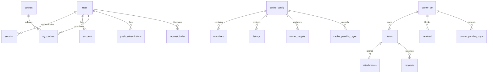

# Communal Cache MVP

## Scope decisions

- Sign in primarily with an email containing only a magic link, no passwords.
  “Email me a code instead” explicitly sends the six-digit code fallback in a
  separate email. No combined link+code email; phone/SMS is deferred.
- Web push for notifications, email via Resend as fallback.
- One library item can be attached to several caches; it is not copied per cache.
  One Owner DO stock count/reservation sum serves every attachment.
- No holder/return tracking or loan lifecycle. The confirmed **Lent out** feature is
  only a manual owner availability flag plus optional short note, shared across
  caches. A request still ends at `approved` or `rejected`.
- Non-consumables have no quantity. Only consumables do.
- Join by unguessable invite link. No password. Optional per-cache owner approval.
- One notification per request. No throttle.
- No addresses stored anywhere.

This is the target architecture, not a description of code already ported. The Go
foundation is live; Go Caches/Joining in PRs #2/#3 are references to be superseded.
The existing deployment and Supabase Postgres stay live until an approved cutover.
This spec change creates no resources and decommissions nothing.

**Shared-items decision (2026-10-15): option B.** The target below replaces the
implemented cache-local item/request model. Owner DO code, bindings and migrations
are not added by this docs PR; existing cache-local tests do not prove the new
protocol. [Build guide](build-guide.md#shared-items-implementation-plan) gives PRs
2–6. Draft #28's cache fan-out Your items view is superseded by PR 5's owner library.
There is no production data on the new stack yet; staging reset/migration and the
later legacy cutover are separately approved operations.

## Data model



One **SQLite-backed Cache DO per cache** owns membership/settings. One **Owner DO
per user**, selected by `idFromName(user_id)`, owns that user's canonical items,
attachments, shared stock, requests and revocation tombstones. Cache `listings`
are display-only projections. D1 holds auth/discovery/outbox, never item permission.
There is no transaction or foreign key across objects, D1 or R2. The diagram's
`owner_do` and two pending-sync labels distinguish object stores, not new D1 tables.

App IDs are text UUIDs generated with `crypto.randomUUID()` before writes; app
user ID equals **Better Auth `user.id`**, with its `generateId: 'uuid'` option.
App timestamps are **integer Unix milliseconds**, supplied by the Worker/DO, with
`created_at NOT NULL`; auth columns retain the pinned library's generated schema
and adapter date conversions. Booleans use SQLite integers constrained to 0/1.
Keys/statuses are `NOT NULL`; nullable quantities/decision timestamps remain
nullable deliberately. All app SQL binds parameters, never interpolated input.

### Global D1

- Better Auth `user`, `session`, `account`, `verification`, and `rateLimit` tables:
  auth identity/email, D1-backed sessions, account records, hashed OTP challenges
  and persistent auth rate limits. App user IDs reference `user.id`; email for
  notifications comes from that user's private auth row. No duplicate app email
  identity or separate `users` table.
- `user.display_name TEXT` — nullable app profile field, declared as a Better Auth
  additional field and set only through `PATCH /api/me`. Do not use the library's
  core `name` (or an email-derived default) as the community display name.
- Auth migrations are hand-written/reviewed SQL derived from the exact pinned
  Better Auth schema generator output, including plugin/rate-limit fields. Apply
  with Wrangler D1 migrations, not a public migration endpoint or runtime auto-DDL.
  The native D1 adapter is documented; no `kysely-d1` dependency is needed.
- `caches` — `id TEXT PRIMARY KEY`, `name TEXT NOT NULL`. A registry/projection,
  **not** the authority on cache ownership, membership, settings, or invite secrets.
- `my_caches` — `PRIMARY KEY (user_id, cache_id)`, both text, references to global
  `user`/caches. Discovers Home caches only; it no longer locates canonical items or
  outgoing requests. Missing/stale rows hide an entry or yield 404, never access.
- `request_index(requester_id, owner_id)` — unique pair of D1 user IDs, discovering
  Owner DOs for the caller's outgoing Requests page. An Owner DO records the index
  intent with request creation. Stale pairs may return no rows; missing pairs may
  delay visibility. Every target still filters by requester; this index never
  authorizes. Incoming requests and Your items use the caller's own Owner DO.
- `push_subscriptions` — `id`, `user_id REFERENCES user ON DELETE CASCADE`,
  `endpoint TEXT UNIQUE NOT NULL`, `p256dh TEXT NOT NULL`, `auth TEXT NOT NULL`.
- `outbox` — `id TEXT PRIMARY KEY` generated in the DO, `kind TEXT NOT NULL`,
  `dedupe_key TEXT NOT NULL`, `UNIQUE(kind, dedupe_key)`, `payload TEXT NOT NULL`
  containing validated JSON, `attempts INTEGER NOT NULL DEFAULT 0`,
  `claim_until INTEGER`, `claim_token TEXT`, `sent_at INTEGER`, `failed_at INTEGER`.
  Payloads snapshot recipient IDs, item titles, reasons and destination links; they
  survive deletion of the originating item. Index unsent work and discovery lookups.

### Each Cache DO's private SQLite database

- `cache_config` — singleton cache UUID/name, secret and approval setting; secret
  remains 32 random bytes/base64url.
- `members` — user UUID, `owner|member`, `active|pending|removed`, creation time.
  Exactly one active **cache owner**; this role is unrelated to item ownership.
- `listings(item_id, owner_id, title, is_consumable, available, unavailable_note,
  photo_version, updated_at)` — display-only item projection, keyed by item UUID.
  Booleans have 0/1 checks; note/photo version are nullable. No R2 key, reservation
  ledger or stock authority lives here. Item detail gets canonical quantity from
  the Owner DO. Projection lag never grants request/photo permission.
- `owner_targets(owner_id PRIMARY KEY, registered_at)` — **not display data**.
  Cache admission for attachment checks the owner active and registers this target
  in the same `transactionSync`, before any Owner DO attachment commits. Retain
  registrations for the cache's lifetime, including after detach. Removal uses
  this table, never eventual listings, to reach every relevant Owner DO.
- `pending_sync` — stable IDs, local sequence, kind/payload/time; registry,
  membership discovery, join notifications and durable owner-target revocations.
- Version metadata; constructor migrations remain atomic and versioned.

### Each Owner DO's private SQLite database

Owner identity is fixed to its user namespace, never a forged request-body owner.
It is independent of cache membership; an unshared item remains in its library.

- `items(id, title, description, photo_path, is_consumable, quantity, available,
  unavailable_note, created_at)` — one canonical row. Type is immutable; quantity
  is integer 0–9999 for consumables, NULL otherwise, with the existing type/NULL
  checks. `available INTEGER NOT NULL DEFAULT 1 CHECK(available IN (0,1))` is the
  manual flag, not the calculated reservable quantity. The optional note is short.
- `attachments(item_id, cache_id, attached_at)` — local item FK/cascade and unique
  `(item_id, cache_id)`. Cache IDs are plain UUIDs, not cross-object foreign keys.
- `requests(id, item_id, cache_id, requester_id, quantity, status, decision_reason,
  decided_at, created_at)` — local item FK/cascade; positive consumable quantity
  1–9999, NULL for reusable; pending/approved/rejected and timestamp/reason checks
  remain. The partial pending index is on **item_id across every cache**, plus
  cache/requester lookup indexes for revocation and party-scoped reads.
- `revoked(cache_id, user_id, revoked_at)` — permanent unique pair tombstones;
  removed members cannot rejoin. Request/attachment operations check both caller
  and item-owner tombstones for that cache. Neither detach nor resend deletes them.
- `pending_sync` — listing upsert/delete, request-index discovery, notification and
  exact/prefix R2 cleanup intents, committed with canonical state in one local
  transaction. One ordered drain; external effects are idempotent.
- Fixed owner identity and version metadata, initialized before serving requests.

No object-local FK reaches D1 users or another object. The Worker enriches public
names by IDs only **after** authorization; never select another user's email.
`is_consumable` cannot change: it would strand reservations across all attachments.

### Manual availability: Lent out (confirmed)

The owner toggles `available` and an optional short note. The flag projects to
**every attached cache** as “Lent out.” `available = 0` rejects new requests with
409 inside the Owner DO transaction; existing pending requests stay pending.
Approving a reusable request offers **Mark as lent out**; when checked, approval
and setting the flag/optional note commit together, with listing-update intents
for every attachment. Unchecked approval does not clear an existing flag. The
owner manually marks it available again. No holder, borrower assignment, due date,
return event or automatic loan/return state is added; requester IDs remain request
parties, not a current-holder record.

### Display name onboarding

First successful email-link or code sign-in starts with `display_name = NULL`. Do not derive a name from the
email's local part: that leaks part of everyone's email to the community.
`requireProfile` returns `409 profile_incomplete` on cache, item and request writes;
the SPA routes to "what should neighbors call you?".

`PATCH /api/me`, push subscription routes and `/api/auth/*` are **exempt**. Gating
profile setup or authentication would leave a new user with no way out.

### The shared-stock guard

For a consumable, in its Owner DO:

`available_quantity = items.quantity - COALESCE(SUM(requests.quantity) WHERE item_id = I AND status = 'pending', 0)`

There is **no cache_id filter** in that sum. The manual `items.available` boolean
is a separate gate, not another stock count. Cache listing projections cannot
reserve stock. A cache-scoped pending queue discloses only that cache's rows;
return a canonical available quantity without exposing other caches' requesters.

Request creation has two completed object operations:

1. Cache DO synchronously checks requester R and item owner O active in cache C,
   and listing I present; it returns internal routing/admission context. This is
   not a browser-supplied “ok” field, reusable bearer ticket or public Owner-create
   bypass; every cache request enters through this Cache check.
2. Owner DO performs all canonical checks and writes in one local transaction:

```typescript
ctx.storage.transactionSync(() => {
  const item = requireItem(itemId);
  requireAttachment(itemId, cacheId);
  requireNotRevoked(cacheId, requesterId);
  requireNotRevoked(cacheId, ownerId);
  requireNonOwnerAndValidQuantity(item, requesterId, quantity);
  if (!item.available) throw conflict();
  if (quantity > item.quantity - pendingAcrossAllCaches(itemId)) throw conflict();
  insertRequestAndNotificationIntent();
  insertRequestIndexIntent();
});
```

Illustrative shape only; reusable requests have NULL quantity and no stock
subtraction. No `await`, RPC, D1/R2/Queue call or SQL cursor crosses that local
check/write boundary. Throw rolls back local state and intents, per the
[documented SQLite semantics](https://developers.cloudflare.com/durable-objects/api/sqlite-storage-api/index.md#transactionsync).

“Writes never await between objects” means **no cross-object await inside an
object's local check/write transaction**. Admission RPCs finish before the Owner
transaction starts; they are not a distributed transaction or a timeless grant.
The Owner rechecks item, attachment, stock and local revocation state. Durable
revocation closes the removal race described below; it is not instant global
rollback. [External awaits can interleave](https://developers.cloudflare.com/durable-objects/api/state/index.md#blockconcurrencywhile).

- **Create**: requester differs from owner; reusable quantity NULL, consumable
  integer 1–9999. Missing attachment/revoked access is 404; unavailable or
  insufficient stock is 409. Request, notification and request-index intents commit
  together. Two caches competing for the same item use this one reservation sum.
- **Approve/reject**: caller owns the Owner DO/item; pending-only guarded transition,
  zero changed rows 409. Approval deducts stock exactly once; rejection requires a
  reason and releases its reservation. Apply the confirmed Lent out checkbox in
  this same transaction. There is no stock copy/deduction in a cache object.
- **Stock edit**: owner-only; cannot fall below the global pending sum. Restock
  remains within 0–9999. Local detach/revocation and decisions serialize here.

Cache membership mutations and Owner item/request mutations each use their own
`transactionSync`; neither Postgres locks nor a transaction spanning objects exist.

## Authorization

### The data boundary

D1 and DO storage are server-side bindings, not a browser-facing database API.
Better Auth runs in our Worker; the browser holds a same-origin session cookie,
not a D1/DO management credential or a provider anon key. Cache access goes through
that Worker and its authoritative DO. The target has no Supabase dependency.

- **`app` schema dropped:** SQLite has no equivalent application schema boundary;
  application tables no longer live in Supabase Postgres.
- **RLS dropped:** D1/DO storage is not exposed through PostgREST; authorization is
  the cache DO's live membership check, not per-user SQL policies.
- **Data API invariant dropped for the target stack:** it has no Supabase service
  or PostgREST tables. Preserve existing protections on legacy Supabase/Postgres
  until approved decommissioning.
- **`DATABASE_URL`/pooling invariant dropped:** bindings replace pgx connections;
  migrations no longer depend on a session advisory lock.

### The photo bucket is private

R2 has no public domain or `r2.dev` access enabled. Uploads use the Worker's R2
binding. Photos use immutable `ownerId/itemId/uploadUUID` keys, not cache-scoped copies.
Cache-context reads check membership/listing in the Cache DO, then attachment and
caller/owner tombstones in the Owner DO before the Worker streams R2 with private,
no-store headers. Owner-library reads authenticate the owner directly. No public
bucket, signed URL or browser storage credential is needed; no authorized image
response is shared-cached.

### Application checks

Cache IDs select membership authority; owner IDs select canonical item authority.
Owner IDs from listing/index/path data only route a call; they never grant it.
Private library routes select the caller's own Owner DO from the authenticated
user, never a body-supplied owner. A pending, removed or non-member still gets
**404, not 403**, on cache-data routes; valid-secret removed joins retain 403.
Do not trust D1, a display listing or a previous request as permission.

| Operation | Cache DO gate | Owner DO gate / local authority |
| --- | --- | --- |
| Cache detail, members, listings | Caller active, same synchronous read | None; listings are display projections |
| Cache settings/joins/removal | Active cache owner; local transaction | Removal delivers registered-target revocations |
| Library create/read/edit/delete/photo | No cache required | Caller is this owner; item existence, local stock/cascade rules |
| Attach item to C | Owner active **and registered in owner_targets atomically** | Owner caller; item exists, owner not revoked in C; commit attachment + listing intent |
| Detach item from C | No cached listing grants a write | Owner caller; remove attachment, reject pending via C, listing-delete/notification intents in one transaction |
| Cache item detail/queue/photo | Caller and item owner active; listing routes to O | Item attached to C; caller/owner not revoked; cache queue rows restricted to C |
| Request create | R/O active, listing present | Item/attachment/tombstones/non-owner/type/manual flag/global stock checks + request/intents in one transaction |
| Request decision | No D1 or listing authorization | Owner caller, matching request, pending-only stock/decision transaction |
| Incoming/outgoing Requests | No my_caches fan-out | Own Owner DO for incoming; request_index discovers outgoing targets, each filters requester/party |

Private library access survives losing one cache membership. A cache owner cannot
edit another member's canonical item merely because they administer that cache.
Private request-target reads return only party-owned request data; they do not
bypass the separate cache/item/photo gates or expose another cache's queue.

Cache creation inserts config plus the owner's active membership and durable
registry/reverse-index intents atomically in the new DO. Navigate straight to that
cache page; do not wait for the eventually updated home-screen list.

The cache-scoped pending queue deliberately returns requester display name,
quantity, `created_at`, `user_id` and `request_id` to active members of **that cache
only** (`requests.cache_id = C`), never other caches' requester identities. Global
stock availability may reflect all-cache reservations without those identities.
Decided requests remain party-scoped to the requester and item owner. IDs support keys and actions;
**app emails appear only in `GET /api/me`, only your own authenticated user**.
Better Auth endpoints may return the caller's own session/user, never another
user's email; do not enable admin/list-users or public user lookup endpoints.

Removal blocks the next Cache DO membership check even with a valid session.
Already authorized in-flight reads are not recalled. Cross-object revocation is
at-least-once/eventual: an in-flight request may commit before its tombstone arrives,
then is rejected if still pending. No surviving pending request is promised only
after durable revocation has converged; an already completed approval is not an
instant distributed rollback. D1/projection drift never grants a new authorization.

## Membership lifecycle

- **Join** `POST /api/caches/{cacheId}/join` with body `{secret}`: Worker opens that
  DO directly; the DO compares the decoded, fixed-length secret in constant time.
  No D1 token lookup table. A mismatch or missing cache returns 404. The secret is
  a shareable bearer capability (anyone with the link may join or ask to join), so
  it travels in the body, not the API path, to keep it out of request logs.
  The SPA `/join/...` page sends `Referrer-Policy: no-referrer`.
- Insert `active`, or `pending` if approval is required. A `removed` member row is
  untouched and returns 403 on the valid-secret join route: otherwise removal is
  meaningless while the link remains in the group chat. This is the explicit join
  exception, not a change to direct cache-data 404s.
- **Join rejected**: delete the pending row, not mark it removed, so a mistaken
  rejection can be retried. Approval/rejection snapshots recipients into
  `pending_sync` before any deletion.
- **Owner** cannot be removed or remove themselves. No ownership transfer.
- **Removal**: one Cache transaction checks its owner, marks R removed, records
  discovery deletion and durable revocation work for **every owner_targets row**.
  It does not delete the person's canonical library or photos. Do not derive
  recipients from eventual listings or my_caches. Delivery is bounded, idempotent,
  at-least-once and re-armed while work remains.

### Registered targets and the removal race

Attach first calls the Cache DO. In one transaction it checks O active and inserts
`owner_targets(O, registered_at)` if absent. **Only after that RPC returns** may O's
Owner DO commit an attachment, guarded by `revoked(C,O)`. Registrations are never
deleted while the cache exists, including on detach/re-attach.

A listing implies an earlier attachment, which implies earlier target registration.
Thus any request that passed Cache admission before removal routes to an owner in
the removal's registered set. Admission after removal fails membership. Listing
projection lag cannot omit a revocation destination. Owner removal between target
registration and attachment commit is covered by the same two delivery orders.

Each target Owner DO applies one transaction:

- Insert permanent `revoked(C,R)`; reject R's pending requests **via C only**, with
  reason “left the cache,” and snapshot notification recipients before changes.
- If R is that Owner DO's owner, detach all its items from C and reject **all**
  pending requests through those attachments. Other caches/library items remain.
- Record listing-delete and notification intents with local changes. Replays must
  not repeat stock deductions or restore permissions.

If the tombstone arrives first, a late request/attachment is refused. If canonical
creation commits first, the later revocation rejects/detaches it. Both orders must
leave no surviving pending request via the removed membership after recovery.
This is a durable convergence rule, not a cross-object transaction or an undo of
an approval already completed before revocation. PR 4 must prove both orders,
registration-before-listing lag, eviction/retry and detach/re-attach cases.

### Detach and global deletion

- **Detach one item/cache**: Owner transaction removes that attachment and rejects
  its pending requests via C, snapshots recipients and records listing deletion.
  Other attachments, shared stock, manual availability flag and private photo stay.
- **Delete the library item**: one Owner transaction snapshots pending requesters
  across every cache, rejects them, deletes the canonical item/local dependent rows,
  and records listing removal for every attachment, notification and R2 cleanup
  intents. Snapshots survive local FK cascade; no request row is needed to deliver.

Destructive endpoints ship only with these local cascades and durable external
work. No await/RPC belongs inside either object's transaction. A racing local
request either fails its attachment/tombstone check or is included in the later
Owner cascade; cross-object removal finishes through the registered-target protocol.

## Backend

One TypeScript module Worker handles HTTP, Queue messages and scheduled sweeps;
exported Cache and Owner DO classes handle their own RPCs/alarms. Plain dispatch,
hand-written SQL, no ORM/router dependency. Each object keeps its local domain
checks and SQL together; global D1 queries stay in one auditable module. New Owner
bindings/class migrations require the separately approved implementation PRs.

- **Auth**: exact pin `better-auth@1.7.7` (published 2026-09-30, more than seven
  days old as checked 2026-10-08). Mount its handler under `/api/auth/*`, with its
  native `database: env.DB` adapter and Worker `nodejs_compat` flag for
  AsyncLocalStorage. No jose, JWT/JWKS, provider anon key or auth service.
- **Sessions**: Better Auth validates its D1-backed session cookie for app requests;
  production cookies are HttpOnly, Secure, SameSite=Lax and host-only. Keep session
  cookie caching and secondary storage off so revocation uses D1, not a stale
  stateless snapshot. Core session/user endpoints return only the caller's data.
- **Surface**: enable `magic-link` and `email-otp`; expose link send, an
  Origin-protected verification POST, code send (`type: 'sign-in'`), OTP sign-in,
  get-session and sign-out under `/api/auth/*`. The plugin's direct verification
  GET is not public. Deny other paths at
  dispatch/disabledPaths, including password sign-in/sign-up, raw-OTP helpers,
  reset/change-email/account management and unused plugins/providers. No admin/
  list-users or password flow. Allow automatic new-user registration through
  successful link or OTP sign-in; both are email-ownership proofs.
- **CSRF**: cookies auto-attach. Configure exact `trustedOrigins` and leave Better
  Auth's CSRF/origin checks enabled. Our own mutating routes also require an
  `Origin` equal to `APP_BASE_URL`; reject missing/null/foreign origins. GET/HEAD
  must not mutate domain state; handle OPTIONS without mutation. Better Auth's
  guards do not automatically protect unrelated app handlers. Local origins are
  development-only, never wildcard production trust.
- **Profiles**: `display_name` stays nullable until `PATCH /api/me`; auth core name
  fields and OTP signup inputs cannot bypass `requireProfile`. Names are user-chosen,
  and public cache/member/request payloads never select email.
- **Email codes**: six digits, expiry 300 seconds, maximum three verification
  attempts; explicitly set `storeOTP: 'hashed'` and `resendStrategy: 'rotate'`.
  A resend replaces the prior code; show "use the newest code". Hashed storage
  cannot recover/reuse a code. Verification/session/rate-limit records stay in D1.
- **Sign-in delivery**: `sendMagicLink` and fallback `sendVerificationOTP` await bounded Resend fetches from
  the auth request, not notification Queue/`waitUntil`. Fail visibly on send error;
  sending-domain verification for `communalcache.com` (or its sending subdomain)
  is an approval-gated prerequisite. Never log codes, cookies or auth tokens.
- **Auth rate limits**: explicitly enable Better Auth's rate limiter in production
  and tests with `storage: 'database'` and the D1 `rateLimit` table. Use trusted
  Cloudflare client-IP headers and stricter send/resend/verify rules; test across
  multiple Worker instances. No per-isolate in-memory counters. `ponytail:` D1
  storage support alone does not certify concurrent challenge/limit behavior;
  concurrent redemption, attempt budgets and counter races are Foundation gates.
- **Schema**: Wrangler-managed D1 SQL migrations; DO constructor migrations under
  `blockConcurrencyWhile`, with a local schema version and atomic migration steps.
  No boot-time global migration runner, pool, or advisory lock. See
  [database.md](database.md).
- **Email**: Resend with `fetch`, no SDK. Escape user input in generated HTML; use
  10-second abort deadlines per provider call within a 30-second delivery deadline.
- **Push**: candidate `@block65/webcrypto-web-push` 2.x for RFC 8291 encryption and
  VAPID via WebCrypto; the app owns fetch options, timeouts and redirect policy.
  Adoption still needs Worker-runtime and provider tests in the Push feature.

### Input validation

Cap actual JSON bytes at 16 KB and photo upload bytes at 5 MB; `Content-Length`
alone is not validation. Reject oversize streams before buffering unchecked data.
Trim required text and reject empty values. Limits: title 120 characters,
description 2000, display name 60, rejection reason 500; request quantity 1–9999.
Return 400 with the field name instead of a constraint error disguised as 500.
Sniff photo content; allow only JPEG/PNG/WebP, never SVG. Client resizing is not a
security boundary.

### Durable cross-store sync

A DO cannot atomically commit another DO, D1, R2 or Queue writes. Each Cache or
Owner DO commits **state plus `pending_sync`** locally, then sets an alarm. [Only one alarm is scheduled per DO](https://developers.cloudflare.com/durable-objects/api/alarms/index.md).

For each ordered pending row, the alarm applies its effects idempotently:

1. Apply cache registry/my_caches effects, Owner listing projections or
   requester-to-owner `request_index` discovery as the intent specifies.
2. For Cache removal, deliver revocation to every registered Owner target. The
   receiver atomically inserts the tombstone, rejects/detaches locally and records
   its own listing/notification intents before acknowledging. Retry is harmless.
3. Insert notification outbox rows by stable **source-DO-generated ID** with
   `INSERT OR IGNORE`, preserving claims/terminal state, then enqueue their IDs.
   Owner and Cache producers use the same guarded delivery pipeline.
4. Apply exact/prefix R2 deletes only for canonical item/photo cleanup; detach or
   membership removal alone does not erase a library photo.
5. Delete a source pending row only after its external effects succeed. A crash
   leaves it replayable; duplicate RPCs/Queue messages are expected. No await is
   inside either source or receiver's local state/intent transaction.

Drain in sequence with **one bounded flush at a time per DO**, including when
`flushSync()` and an alarm overlap: an old projection intent must not overwrite a
newer removal or name change. Async external work is outside the local transaction;
never carry a SQL cursor or unchecked authorization decision across it.

Alarm handlers catch failures and re-schedule while work remains. Built-in retries
start at 2 seconds but stop after six retries; they are not the durable recovery
policy. **Every DO entry point re-arms an alarm when pending rows exist**, including
reads and `flushSync`. A Cron Trigger walks the D1 registry in bounded pages and
calls known Cache DOs' `flushSync()` as a backstop. Owner work also needs a bounded,
durable recovery sweep over known owner IDs (for example D1 `user.id` pages, not
emails or a public users endpoint). Cache/Owner/outbox pages must share invocation
budgets with headroom, not blindly add another 25 RPCs. Owner sweep/cursor/budget
integration is **UNVERIFIED** until PR 2's local failure/recovery tests. Namespace
bindings have no list method; do not add management credentials to enumerate them.

Cache creation generates the cache UUID in the Worker and invokes
`DO.create(owner, name)`: config, owner membership, registry and reverse-index
intents commit together. The client can immediately navigate to the DO-backed
cache page even before D1 discovers it.

`ponytail:` cross-store sync is eventual, and a brand-new cache whose first alarm
was never scheduled is not yet discoverable by the registry sweep. An entry-point
retry re-arms it. The implementation must test the local commit/alarm crash window;
the upgrade path is durable alarm scheduling alongside the local intent or a
separate creation-recovery registry. No atomic DO-to-D1 guarantee is claimed.

### Notification delivery

Delivery is **at-least-once**, not exactly-once. A crash after a provider accepts
but before recording success can duplicate a send; duplicates are better than a
missed notification.

D1's outbox is filled by durable DO intents. After sync, Queue messages carry only
outbox IDs. No cache mutation calls a notification provider inline.

1. Consumer guarded claim: update attempts, claim token and expiry where
   `sent_at IS NULL AND failed_at IS NULL` and the claim is absent/expired.
   Check D1 `meta.changes`; zero means acknowledge and skip. Use a lease longer
   than the 30-second whole-row delivery deadline, initially 90 seconds.
2. Send outside storage transactions. Deliver push to live subscriptions, otherwise
   email. Respect provider and whole-row abort deadlines and connection limits.
3. Success sets `sent_at`; an **observed** failure at `attempts >= 6` sets
   `failed_at`. Both writes keep `AND sent_at IS NULL AND failed_at IS NULL` and
   the current claim token, so stale consumers cannot overwrite a new claim.
4. Retry transient failures through Queues; release the consumer's own claim on an
   observed retryable failure. A crash leaves its lease to expire. Acknowledge a
   message only after durable terminal recording, or when no claim was acquired.

**Eligibility is never bounded by `attempts`**. A crash during the sixth claim
must remain recoverable; `failed_at` is written only after an observed failure.
Attempts count claims, including crashes, not just provider failures. Queues owns
redelivery/retry delays; no custom polling/backoff worker. Configure its retry
policy explicitly: the default is only three retries and exhausted messages can
be deleted. A Cron sweep re-enqueues nonterminal outbox rows older than a few
minutes whose claims have expired; it also repairs a failed post-commit Queue send
or an expired Queue message. Bound sweep batches to platform quotas.

The outbox and pending-sync mechanisms land with the features that create events,
not with delivery. Intermediate builds retain notification intents even before
the Queue consumer exists.

Channel choice is **structural, not escalation**. Email is sent iff there are no
live push subscriptions: none registered, or all returned 404/410 this pass. Delete
expired subscriptions and email in that same pass. Transient push errors retry
push, not escalate to email. `ponytail:` a flaky endpoint across the entire retry
window can lose that notification; the in-app requests queue remains the backstop.
An escalation upgrade needs a separate observed-failure counter, not `attempts`.

### Who gets notified

| Event | Recipient |
| --- | --- |
| Request created | Item owner |
| Request approved/rejected | Requester |
| Item deleted | Everyone with a pending request on it |
| Member removed | Requesters whose requests were rejected as a result |
| Gated join requested | Cache owner |
| Join approved/rejected | Person who asked |

Each mutation records these recipients and the needed title/reason/link in its
local transaction. A thrown mutation records no sync or notification intent.

### Push endpoints are untrusted input

- Exact origin allowlist at subscribe **and send**: `fcm.googleapis.com`,
  `updates.push.services.mozilla.com`, `web.push.apple.com`, and subdomains ending
  in `.notify.windows.com` with a hostname boundary check, not substring matching.
- HTTPS only, port 443/default only, no userinfo; reject private/metadata IP literals,
  localhost, internal hosts and everything off the allowlist.
- Explicit `redirect: 'manual'`; reject 3xx rather than following. A newly created
  Request defaults to `follow`, [per Cloudflare](https://developers.cloudflare.com/workers/runtime-apis/request/index.md).
- Push and Resend calls use the deadlines above. Never give the push sender VPC or
  arbitrary private-network bindings.

**UNVERIFIED:** complete production `fetch()` blocking of private, loopback,
link-local/metadata addresses and DNS rebinding. Cloudflare's security model
states a broad internal-network restriction, but not an enumerated guarantee.
Do not say moving to Workers removes SSRF risk. `ponytail:` Worker fetch exposes no
DNS-resolution/dial hook for the old IP-level egress guard; the strict origin
allowlist is the control. If stronger resolved-IP enforcement is needed, use a
vetted egress proxy rather than claiming an app-level IP check exists here.

### Endpoints belong to browsers, not accounts

An endpoint identifies a browser installation. A shared iPad may subscribe under
another account: `ON CONFLICT(endpoint) DO UPDATE` must reassign `user_id`, `p256dh`
and `auth`, not ignore the conflict. Otherwise that browser receives the previous
account's notifications. Logout deletes the endpoint with a caller-scoped
`DELETE /api/push/subscribe`.

### Routes

These are the **planned shared-model routes**, not endpoints added by this docs
PR. Cache context selects the Cache DO; its authorized listing supplies the owner
routing ID. Private library/decision routes select the caller's Owner DO directly.
Plain UUIDs remain; wrong cache/attachment/owner access is 404. There is no D1 item
locator or permission granted by an owner ID. Existing cache-local routes remain
implementation history until PRs 2–4 port/gate them; never leave old cache stock
writes active for the same shared item.

- `GET /api/config` — app base URL, Better Auth public base URL, VAPID public key;
  runtime config, no secret build inputs.
- `/api/auth/*` — only approved Better Auth code/sign-in/session/sign-out paths;
  exempt from profile gate, with auth CSRF/origin/rate-limit protections.
- `GET /api/healthz`
- `GET/PATCH /api/me`
- `GET/POST /api/caches`, `GET/PATCH /api/caches/{cacheId}`
- `POST /api/caches/{cacheId}/invite/rotate`
- `POST /api/caches/{cacheId}/join` (body `{secret}`)
- `GET /api/caches/{cacheId}/join-requests`,
  `POST /api/caches/{cacheId}/join-requests/{userId}/approve|reject`
- `DELETE /api/caches/{cacheId}/members/{userId}`
- `GET/POST /api/me/items`, `GET/PATCH/DELETE /api/me/items/{itemId}` — own library,
  including unattached items; PATCH includes the manual availability flag/note.
- `POST/GET /api/me/items/{itemId}/photo` — owner upload/private library read.
- `PUT/DELETE /api/me/items/{itemId}/attachments/{cacheId}` — register-then-attach,
  or canonical detach with cache-scoped rejection and listing cleanup.
- `GET /api/caches/{cacheId}/items` — membership-checked display listings.
- `GET /api/caches/{cacheId}/items/{itemId}` and `GET .../photo` — Cache admission,
  then Owner attachment/tombstone checks; never a public R2 URL.
- `GET/POST /api/caches/{cacheId}/items/{itemId}/requests` — cache-scoped queue/
  admission, then canonical Owner request transaction.
- `POST /api/me/requests/{requestId}/approve|reject` — caller's Owner DO decisions.
- `GET /api/requests` — incoming from own Owner DO; outgoing from bounded
  `request_index` owner discovery, each target filtering the caller's request rows.
  Missing/stale discovery may hide/empty a result, never authorize it.
- `POST/DELETE /api/push/subscribe`

`ponytail:` outgoing requests use bounded owner discovery, not a whole-registry or
my_caches scan. Start with at most 25 owner targets/page and five concurrent RPCs,
with continuation, row bounds and budget tests in PR 3. Your items calls one own
Owner DO (paginate its rows), not cache fan-out. Free Workers' 50-query/subrequest
ceilings still need auth/profile/name headroom; exact new-model budget/CPU fit is
**UNVERIFIED**. Return partial-unavailable/error states rather than an empty queue
on RPC failure; raising limits requires measurement, not index-based permission.

## Frontend

React + TypeScript + Vite in [web/](../web/), Workers static assets instead of a Go
embed. React Router handles invite links; TanStack Query handles server state;
Tailwind, mobile-first layout and bottom navigation remain.

Screens: login, display-name onboarding, dashboard (my caches/create/join), cache
view (listings/members), item detail with "Ask to use", library/add-item, requests,
join link. Home's **Your items** is the caller's Owner DO library, with attached
caches shown under each item, including items shared nowhere. Cache **Add item**
offers **Existing item** or **New item**; a new item is created once in the library,
then attached. Item detail has owner cache checkboxes for attach/detach. A failed
attach leaves a visible/retryable library item, not a silently duplicated item.
The manual Lent out toggle/note and approval checkbox update every attachment's
display through durable projections; they add no holder/return workflow.

**Invite through login.** `/join/:token` carries `cacheId.secret`; stash the
pending cache ID and secret in `sessionStorage` before requesting a code. The user
stays on that page to enter the six digits, then chooses a name if needed. Resume
`POST /api/caches/{cacheId}/join` with `{secret}` in its body; clear the stash after
success or explicit cancellation. No auth callback or emailRedirectTo is needed.
The invite page keeps `Referrer-Policy: no-referrer`; never put the join secret in
an auth email, callback URL, analytics event or API request path.

**Photos.** Resize to max 1600px and re-encode JPEG via canvas. Decode and `toBlob`
can fail; show "couldn't read that image, try another" instead of uploading a blank
frame. Owner-only upload checks the canonical item in the Owner DO, then rechecks
owner/item existence after R2 I/O before setting its photo and cleanup/listing
intents atomically. Losing one cache does not delete or prevent editing a retained
library item. Clean orphan/replaced versions by exact owner-scoped keys; R2 and DO
state are not atomic. Cache reads check membership/listing then Owner attachment/
tombstones every time. Lists use same-origin cookie-authenticated ``
routes with private headers, never public/signed URLs or bearer/blob workarounds.

**Push.** Service worker and PWA manifest. iOS Safari has no programmable install
prompt; render "Share, then Add to Home Screen" instructions. Permission requests
must follow an explicit user gesture, and on iOS only inside the installed PWA.

## Auth follow-ups

### Magic links (implemented locally)

User-approved product decision: the primary login action sends an email containing
**only a magic link**. The secondary “Email me a code instead” action sends the
existing six-digit OTP email and displays code entry. There is no combined email,
shared challenge or cross-invalidation promise. Both prove email ownership; codes
retain hashing/rotation/three attempts and migration 0003 unchanged.

Better Auth 1.7.7's `magic-link` plugin uses `expiresIn: 300`, `storeToken: 'hashed'`
and `sendMagicLink({email, url, token})`. Its `magic-link:<SHA-256/base64url>` rows
reuse D1 verification storage and do not match migration 0003's `sign-in-otp-*`
partial unique index. No migration or dependency upgrade is required. Each token
is consumed **atomically on the first verification call**, even if later session
creation fails. Do not enable deprecated multi-attempt redemption. A resend creates
an independent token; previously sent links remain valid until used or expired.
“Use the newest link” is guidance, not a claim of latest-link-only rotation.

Mail links to `/auth/link#token=...` on fixed `APP_BASE_URL`, never the plugin's GET
verify URL. Fragment tokens do not reach HTTP logs/referrers; the landing response
also sends `Referrer-Policy: no-referrer` and `Cache-Control: no-store`. The page
captures the fragment in memory and removes it from browser history. Page load,
preview and scanner GET/HEAD consume nothing. An explicit **Continue** sends the
token in JSON to `POST /api/auth/magic-link/verify`. Failed verification stays on
the page and offers a new link or code; reloading after fragment removal also
requires a new link. Never log tokens, request bodies or auth mail.

The pinned plugin only implements GET verification. The Worker rejects public GET
and adapts the exact-Origin-checked POST into an **internal HTTP-handler request**,
not `auth.api` or a network fetch. This retains Better Auth's D1-backed 5/60s
per trusted-IP/path limiter on both send and verify. Plugin redirects become JSON
success/callback or a generic invalid-link error, with the session cookie preserved.
No password/admin/public-user endpoint is enabled. Session cookies and profile
exemptions remain unchanged; successful account changes discard old private UI
queries and reconcile any previous-account browser push registration.

Resolve `callbackURL`, `newUserCallbackURL` and `errorCallbackURL` against fixed
`APP_BASE_URL`, allowing only that exact origin and rejecting protocol-relative,
credential-bearing and foreign URLs. Relative callbacks are normalized; new-user
and error callbacks default to the normal callback. Pending joins stay in this
tab's sessionStorage, never auth metadata, callback secrets or mail. Same-tab
verification resumes the saved join after name onboarding. A link also works in a
fresh/different browser without any requesting-browser cookie or challenge state;
that browser does **not** receive the original tab's saved invite. Reopen the invite
there, or use the code fallback in the original tab. Actual mobile mail-client
handoff and live Resend delivery remain **UNVERIFIED** pending approved smoke.

Local runtime/UI proofs cover scanner GET, explicit Continue/session, concurrent
single redemption, replay/expiry, failure after consumption, Origin/callback
rejection, provider failure/timeout, D1-backed send/verify limits, code fallback
and pending-join retention. [Official plugin reference](https://www.better-auth.com/docs/plugins/magic-link.md).

### SMS (deferred / out of scope)

No phone numbers, SMS plugin, SMS account or sender is provisioned. Better Auth's
`phone-number` plugin needs our own `sendOTP` implementation and an SMS provider.
A future proposal must address US business sender registration/compliance for the
chosen sender type, cost caps, resend/rate limits and SMS-pumping protection before
approval. It is not part of Foundation or Features 1–9.

## Checks

Tests arrive with each feature. Use Vitest + `@cloudflare/vitest-plugin` to run
against local Worker runtime bindings: real local DO SQLite and D1, **not mocked
SQL**. Apply D1 migrations in test setup using `readD1Migrations` and
`applyD1Migrations`; exercise DO storage and alarms with `runInDurableObject` and
`runDurableObjectAlarm`. Mock external provider HTTP calls, not invariants.

- **Foundation**: migrations on empty D1/DO, schema version upgrade, Worker API
  errors stay JSON instead of falling through to SPA assets; health/config; no secrets.
- **Auth/profile**: correct, expired, replayed and wrong six-digit codes; three
  failed attempts, resend rotation invalidates the old code, hashed verification
  storage, concurrent redemption/attempt/limit races across Worker instances,
  expired/revoked/tampered cookies, logout and production cookie flags. Reject
  cross-origin/missing-Origin app mutations and auth CSRF; disabled password/admin
  paths unavailable. Profile gate exempts `/api/auth/*`, `PATCH /api/me` and push;
  email stays caller-only, and auth core name cannot bypass profile onboarding.
  Resend timeout/failure surfaces correctly without Queue dependency.
- **Authorization**: non-member/pending/removed/active/item-owner/cache-owner
  matrix across nested routes; wrong cache ID and forged owner get 404; stale
  `my_caches`/registry never authorize. Separate name enrichment does not fetch email.
- **Membership**: open/gated joins, rejected join retry, removed rejoin 403,
  owner cannot leave; constant-time secret comparison and rotation.
- **Requests**: concurrent creates through two different caches never overbook one
  Owner item; approvals deduct once; approve-after-reject 409; stock edits respect
  the all-cache pending sum; NULL/reusable and positive/consumable quantity rules.
  Lent out blocks new requests, keeps pending rows and applies the approval
  checkbox/flag/listing intents in the same Owner transaction.
- **Sync**: injected crash after local commit, after each external effect and before
  pending-row deletion replays idempotently; no duplicate D1 outbox row; Queue failure
  preserves intent; removal/name updates cannot be undone by reordered drains;
  failures beyond six alarm retries still re-arm; reads re-arm; registry Cron flush;
  newly created cache opens immediately despite a missing reverse-index row.
- **Destruction**: Cache removal snapshots every permanent owner target; both
  delivery orders reject/refuse raced requests after convergence. Prove owner
  removal between registration and attach, listing lag, detach/re-attach and
  failures beyond six retries. Losing C preserves library items/photos/other
  attachments. Global delete snapshots every pending recipient before cascade;
  local rollback leaves no partial state or intent.
- **Outbox**: guarded claim competition; crash after sixth claim remains eligible;
  mixed crashed claims and observed failures reach the give-up threshold;
  stale claim cannot stamp failed over sent; Queue/Cron duplicates harmless once
  terminal; correct event recipients, HTML escaping and provider deadlines.
- **Push**: no subscriptions gives email; 404/410 cleanup plus same-pass email;
  transient errors do not escalate; origin/HTTPS/userinfo rejection; manual redirect
  refusal, account reassignment/logout; RFC 8291/VAPID Worker-runtime tests. Local
  tests do not prove production private-IP/DNS restrictions.
- **Photos**: caps/sniffing/SVG rejection; owner-only upload and re-check race;
  anonymous/non-member photo read 404, active member can stream, removal blocks the
  next read; R2 never public, private cache headers; orphan cleanup.
- **Onboarding**: logged-out invite → email code on the same page → display name
  → original join POST body, with sessionStorage preservation and no-referrer.
- **Magic links**: scanner GET/HEAD of the fragment landing page consumes nothing;
  Continue's Origin-protected POST verifies once; concurrent/replay/expired calls
  fail without extra sessions; callbacks stay same-origin. Prove D1-backed 5/60s
  send/verify limits, delivery failure/timeout, fresh-browser redemption, link-only
  mail, explicit code fallback and tab-local pending-invite preservation.
- **Aggregation/library**: request_index forgery/drift cannot authorize requester
  reads; bounded owner fan-out/continuation and explicit unavailable states. Own
  library needs no cache discovery; add Existing/New creates one canonical item,
  cache checkboxes alter only attachments. Never disclose another cache's pending
  requester names through a cache-scoped queue.

The Owner model, registration/revocation convergence and new migration paths are
**UNVERIFIED implementation gates**, not facts proved by existing cache-local
runtime tests. This docs PR adds no storage/runtime test implementation.

Completion gates: Worker/frontend TypeScript checks, whole Vitest suite, frontend
build, empty local migrations and versioned DO upgrades, Wrangler dry-run bundle,
and local `/api/healthz` with SPA deep links. Commands after the port live in
[build-guide.md](build-guide.md). Accessibility checks labels, visible focus,
keyboard-reachable sheets/modals and contrast.

Manual post-deploy smoke (only with approval): Resend sign-in code from the auth
request, separate Queue-driven notification email, an authorized photo, installed
iOS push, Queue/Cron recovery and migration-compatible Worker update. A successful
code email does not prove notification delivery. Magic-link smoke separately proves
scanner-safe Continue, link-only mail and different-browser handoff after approval.

## Deployment

The shared target deploys one Worker/SPA with Cache and Owner SQLite DO namespaces,
global D1, private R2, Queue producer/consumer and bounded recovery Cron work.
This docs PR adds no binding, migration, trigger or deployment. Ensure `/api/*` executes
the Worker before SPA fallback. Set a current compatibility date supporting RPC
and the selected error-serialization behavior; document it in the Foundation port.
See [deploy.md](deploy.md) for the operator sequence and approval boundaries.

Intended production URL: **`https://communalcache.com`**, on the user's Cloudflare
account; domain routing/provisioning still needs approval. Public config:
`APP_BASE_URL`, `BETTER_AUTH_URL` (equal to APP_BASE_URL), `VAPID_PUBLIC_KEY`,
`EMAIL_FROM`. Secrets: `BETTER_AUTH_SECRET`, `RESEND_API_KEY`, `VAPID_PRIVATE_KEY`.
Pass Worker bindings explicitly to Better Auth; do not assume process.env reads
those bindings. No target Supabase keys, DATABASE_URL or browser R2 credential.
Never commit local secret files.

One-time setup, **with explicit approval**:

- Cloudflare resources/bindings, public app URL, private R2 settings, Queue/Cron
  configuration and secrets. No promise that the whole app fits free quotas.
- Resend verification of `communalcache.com` or its sending subdomain; `EMAIL_FROM`
  is on that verified domain, used for both auth codes and notification email.
- Better Auth reviewed D1 schema, stable secret, exact base URL/trusted origin,
  Secure cookie policy, nodejs_compat and database-backed auth rate limits.
  No Supabase setup step exists for the target.

During the separately approved migration, map existing Supabase users by **verified
email** to inserted Better Auth user rows; preserve app display names and rewrite
all user_id/owner_id/requester_id references in D1, both DO classes and pending/
outbox payloads. Canonical items go to their owners' DOs; cache relationships become
attachments/listings, requests move to those Owner DOs, and request_index is rebuilt
from authorized canonical rows. Do not guess that equal titles are the same item;
any legacy deduplication needs an explicit approved mapping. Detect duplicate/unverified emails before mapping; never link by an
unverified claim. Do not carry old sessions/JWTs into Better Auth: users prove
email ownership with a new code. Keep the legacy Fly app and Supabase live until
reconciliation, recovery and approved cutover are complete. Decommissioning
requires separate approval; no auth/provider settings change in this docs PR.

## Known tradeoffs

- **Split authority, not a policy wall.** Cache membership and Owner canonical
  state cannot share a transaction. Enforce local transactions, mandatory target
  registration and durable tombstones; never call a listing/admission snapshot a
  distributed grant. D1 discovery never authorizes.
- **Cross-store drift.** Each object's state commits before another DO/D1/R2/Queue
  effect. Durable intents, replay, alarms and bounded Cron converge them, not a
  distributed transaction. Listings/names/outgoing discovery may lag; membership
  and canonical Owner reads still gate access. Cache pre-registry creation remains
  the explicit recovery window; Owner sweep integration needs new runtime proof.
- **One stock ledger per owner.** Requests across every cache contend in that
  owner's DO; a popular owner is a hotspot. Cache listings reduce read fan-out,
  not stock serialization. Keep external awaits outside local transactions.
- **Monotonic revocation metadata.** owner_targets and revoked grow with cache
  history; retain them unless a separately proved GC protocol is approved. Removal
  must durably cover all registered targets and deliver in bounded batches.
- **Eventual removal delivery.** Membership blocks immediately at the Cache DO;
  in-flight canonical writes may precede their tombstone. Recovery guarantees no
  surviving pending row only after convergence, not instant rollback of approved
  requests. Both orders and failed delivery must be proved before enabling writes.
- **Invite link is a bearer secret.** Forwarding grants access; high entropy,
  rotation, approval gating and removed-member denial mitigate it.
- **At-least-once notifications.** Crashes/Queue replay/Cron can duplicate sends;
  guarded claims/terminal state reduce duplication, not eliminate it.
- **No transient-push email escalation.** The app's visible queue remains the
  backstop for a missed notification.
- **Global item deletion erases its request history.** No audit trail by design;
  pending requesters across caches get durable snapshots. Detach/removal rejects
  only affected cache requests and preserves the library item.
- **Auth is now our responsibility.** Better Auth sessions/challenges/rate limits
  live in D1 and sessions can be revoked; cookie caching stays off. Schema/version,
  CSRF, delivery and rate-limit behavior must be tested in the Worker runtime.
  Cache removal still relies on its DO, not auth session metadata.
- **Link-first with code fallback.** A scanner-safe Continue button adds one click
  but prevents preview GETs from consuming links. Different-browser links sign in
  there; sessionStorage invites stay in the original tab. Code fallback keeps that
  invite tab in place. Links and codes are independent challenges, not a combined
  or cross-invalidated credential.
- **Free quotas are ceilings, not a deployment guarantee.** HTTP Worker CPU is
  10 ms on Free; auth/encryption/fan-out must be measured. D1/DO rows, Queue
  operations/retention and R2 operations are separate budgets. Use small batches
  and monitor backlog/CPU; a paid upgrade needs approval.

## Verified platform facts

Cloudflare facts checked 2026-10-07; Better Auth facts checked 2026-10-08.
VERIFIED means documented platform/library support, not a
production execution test. Remaining UNVERIFIED items are implementation gates,
not grounds to quietly weaken authorization or notification recovery.

| Fact | Verdict and short source quote | Source |
| --- | --- | --- |
| DO local SQL transaction | **VERIFIED:** “If `callback()` throws an exception, the transaction will be rolled back”; callback must be synchronous, intended for `sql.exec()`. | [SQLite storage](https://developers.cloudflare.com/durable-objects/api/sqlite-storage-api/index.md#transactionsync) |
| DO across external awaits | **VERIFIED:** reserve `blockConcurrencyWhile` for “external async calls”; its timeout is 30 seconds. No whole-handler serialization guarantee. | [State](https://developers.cloudflare.com/durable-objects/api/state/index.md#blockconcurrencywhile) |
| DO alarms | **VERIFIED:** “guaranteed at-least-once execution”; exponential backoff starts at 2 seconds, “up to 6 retries”; one scheduled alarm. | [Alarms](https://developers.cloudflare.com/durable-objects/api/alarms/index.md) |
| DO bindings/RPC | **VERIFIED:** env contains configured bindings; RPC requires `2024-04-03` or `rpc`; thrown errors propagate as new error objects. | [DO env](https://developers.cloudflare.com/durable-objects/api/base/index.md#env), [RPC](https://developers.cloudflare.com/workers/runtime-apis/rpc/index.md), [errors](https://developers.cloudflare.com/workers/runtime-apis/rpc/error-handling/index.md) |
| DO enumeration | **VERIFIED:** namespace binding has no list method. Management REST can list objects but needs a privileged token; it is not used for app sweeps. | [Namespace](https://developers.cloudflare.com/durable-objects/api/namespace/index.md), [REST list](https://developers.cloudflare.com/api/resources/durable_objects/subresources/namespaces/subresources/objects/methods/list/index.md) |
| DO Free usage | **VERIFIED:** 100,000 requests/day, “13,000 GB-s / day”, 5 GB total storage, unlimited objects, 100 classes. **UNVERIFIED per-object ceiling:** summary says 10 GB, same-page FAQ says 1 GB Free; plan conservatively for 1 GB. | [Pricing](https://developers.cloudflare.com/durable-objects/platform/pricing/index.md), [limits](https://developers.cloudflare.com/durable-objects/platform/limits/index.md) |
| D1 batch/serialization | **VERIFIED:** failure “rolls back the entire sequence”; each database “processes queries one at a time”. No interactive transaction is exposed by the documented binding; object-local read/decide/write uses DO SQL instead. `changes()` carrying across D1 batch statements is **UNVERIFIED** and not used. | [D1 binding](https://developers.cloudflare.com/d1/worker-api/d1-database/index.md#batch), [limits](https://developers.cloudflare.com/d1/platform/limits/index.md) |
| D1 Free | **VERIFIED:** 5 million rows read/day, 100,000 written/day, 5 GB account storage; 500 MB/database and 50 queries/Worker invocation. | [Pricing](https://developers.cloudflare.com/d1/platform/pricing/index.md), [limits](https://developers.cloudflare.com/d1/platform/limits/index.md) |
| Workers Free/Cron | **VERIFIED:** 100,000 HTTP requests/day, “10 milliseconds of CPU time per invocation”; 5 Cron Triggers/account. Waiting on I/O is not CPU time. | [Pricing](https://developers.cloudflare.com/workers/platform/pricing/index.md), [limits](https://developers.cloudflare.com/workers/platform/limits/index.md) |
| Queues Free/retries | **VERIFIED:** 10,000 operations/day, 24-hour retention; typical write/read/delete is three operations/message; default delivery retry count is three, then deletion or DLQ. | [Pricing](https://developers.cloudflare.com/queues/platform/pricing/index.md), [retries](https://developers.cloudflare.com/queues/configuration/batching-retries/index.md) |
| R2 free tier | **VERIFIED:** “10 GB-month / month”, 1 million Class A and 10 million Class B operations/month, free egress; Standard storage only. Not a hard zero-billing cap. | [Pricing](https://developers.cloudflare.com/r2/pricing/index.md) |
| Rate Limiting binding | **VERIFIED:** 10/60-second periods; per-location, “permissive, eventually consistent”, not accurate accounting. **UNVERIFIED:** Free-plan availability/pricing in the reviewed docs; do not confuse their free/paid-customer example with account plans. | [Binding](https://developers.cloudflare.com/workers/runtime-apis/bindings/rate-limit/index.md) |
| Fetch redirects/private destinations | **VERIFIED:** new Request defaults to `follow`, so set `manual`. **UNVERIFIED:** enumerated private/loopback/link-local/metadata and DNS-rebinding blocking; broad quote only: “not to internal services”. | [Request](https://developers.cloudflare.com/workers/runtime-apis/request/index.md), [security model](https://developers.cloudflare.com/workers/reference/security-model/index.md) |
| Better Auth on Workers | **VERIFIED:** “Better Auth uses `AsyncLocalStorage`”; documented `nodejs_compat` flag (Hono example is not a router requirement). Pin 1.7.7, npm publication 2026-09-30T21:30:55.572Z, over seven days old. | [Workers integration](https://www.better-auth.com/docs/integrations/hono.md), [npm metadata](https://registry.npmjs.org/better-auth) |
| Better Auth native D1/schema | **VERIFIED:** official example uses `database: env.DB`; tagged 1.7.7 source selects its built-in D1 dialect, `transaction = false`. Other-relational docs still list community kysely-d1, but that dependency is unnecessary. Generate/review SQL, then apply hand-written Wrangler migrations. | [Database](https://www.better-auth.com/docs/concepts/database.md), [tagged dialect](https://github.com/better-auth/better-auth/blob/v1.7.7/packages/kysely-adapter/src/dialect.ts#L184-L194), [older community listing](https://www.better-auth.com/docs/adapters/other-relational-databases.md) |
| Email OTP | **VERIFIED:** otpLength 6, expiresIn 300, allowedAttempts 3; storeOTP supports hashed (default plain); reuse “Falls back to rotate when the OTP is hashed”. Target explicitly hashes and rotates. | [email-otp](https://www.better-auth.com/docs/plugins/email-otp.md) |
| Cookie sessions/CSRF | **VERIFIED:** HttpOnly/Secure production cookies, SameSite=Lax; trustedOrigins/CSRF guards documented. App Origin checks remain our responsibility; no auth cookie cache. | [Cookies](https://www.better-auth.com/docs/concepts/cookies.md), [security](https://www.better-auth.com/docs/reference/security.md) |
| Magic links | **VERIFIED in pinned source/local runtime:** sendMagicLink receives email/url/token; expiresIn 300, storeToken hashed, atomic single use and D1-backed 5/60s limits. GET-only plugin is behind an app POST/fragment/Continue adapter; callbacks are exact-origin. Link-only primary and separate OTP fallback are the approved product; no combined lifecycle is claimed. **UNVERIFIED:** live mobile mail-client handoff/delivery. | [magic-link](https://www.better-auth.com/docs/plugins/magic-link.md) |
| Better Auth rate limits | **VERIFIED:** memory is default; `storage: 'database'` and rateLimit table documented. **UNVERIFIED:** this app's multi-instance D1 counter/redemption behavior; test it rather than infer atomicity from adapter support. | [Rate limits](https://www.better-auth.com/docs/concepts/rate-limit.md) |
| Resend and deferred SMS | **VERIFIED:** sending domain must be verified; phone-number plugin requires our sendOTP implementation. SMS is deferred; US business sender registration/compliance depends on provider/sender type (not provisioned here). | [Resend domains](https://resend.com/docs/dashboard/domains/introduction.md), [phone-number](https://www.better-auth.com/docs/plugins/phone-number.md), [US A2P 10DLC](https://www.twilio.com/docs/messaging/compliance/a2p-10dlc) |
| WebCrypto push candidate | **VERIFIED from README/source:** `@block65/webcrypto-web-push` 2.0.0 “works with … Cloudflare Workers”; RFC 8291 `aes128gcm`, RFC 8292 VAPID, WebCrypto rather than Node crypto. Released 2026-09-03; npm reports 443,998 downloads for 2026-09-05–2026-10-04. **UNVERIFIED:** this app's runtime/provider integration and CPU budget, especially installed iOS push. | [Tagged README](https://github.com/block65/webcrypto-web-push/blob/v2.0.0/packages/web-push/README.md), [crypto source](https://github.com/block65/webcrypto-web-push/tree/v2.0.0/packages/web-push/lib), [npm metadata](https://registry.npmjs.org/%40block65%2Fwebcrypto-web-push), [downloads](https://api.npmjs.org/downloads/point/last-month/%40block65%2fwebcrypto-web-push) |
| Local runtime/migrations | **VERIFIED:** `@cloudflare/vitest-plugin` runs tests in Workers runtime; `readD1Migrations` + `applyD1Migrations` apply local D1 schema; DO test/alarm helpers exist. Old pool package is renamed: “will not receive future updates”. | [Plugin](https://developers.cloudflare.com/workers/testing/vitest-integration/index.md), [migration config](https://developers.cloudflare.com/workers/testing/vitest-integration/configuration/index.md#readd1migrationsmigrationspath), [helpers](https://developers.cloudflare.com/workers/testing/vitest-integration/test-apis/index.md), [Wrangler migrations](https://developers.cloudflare.com/workers/wrangler/commands/d1/index.md#d1-migrations-apply), [npm deprecation](https://registry.npmjs.org/%40cloudflare%2fvitest-pool-workers/latest) |
